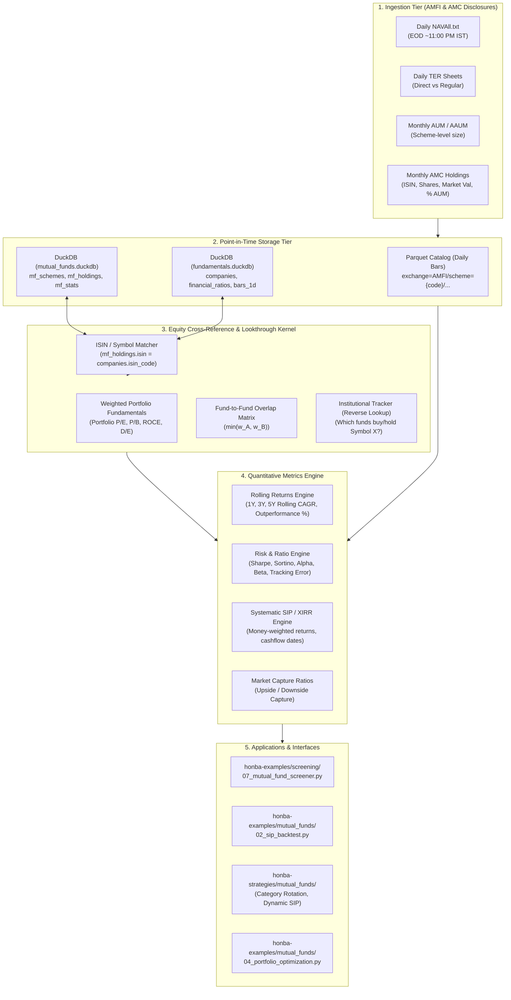
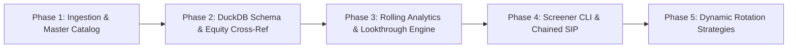

# Honba Mutual Funds Architecture & Screening Roadmap

**Document Status**: Specification & Implementation Roadmap  
**Version**: 1.1 (2026-10-14)  
**Target Repositories**: `honba`, `honba-data`, `honba-strategies`, `honba-examples`, `honba-docs`  
**Author / Maintainer**: Honba Labs Architecture Working Group  

---

## 1. Executive Summary & Vision

Systematic equity trading and quantitative mutual fund research operate on fundamentally different axioms:
- **Equities**: Driven by continuous order books, intraday microsecond ticks, volume-weighted execution, and quarterly corporate financial statements.
- **Mutual Funds**: Driven by once-daily end-of-day Net Asset Values (NAV), zero order books (orders settle at EOD NAV), monthly portfolio disclosures, daily Total Expense Ratio (TER) drag, and category-relative benchmarking governed by SEBI's categorisation mandates.

This roadmap details the end-to-end architectural plan to elevate Mutual Funds into a first-class quantitative asset class within Honba. The goal is to provide **institutional-grade mutual fund screening, point-in-time factor analysis, rolling risk/return modeling, portfolio holdings lookthrough cross-referenced with the equity database, and systematic SIP / category rotation backtesting** for Indian investors and fund allocators.

---

## 2. High-Level Architecture & Equity Cross-Reference Data Flow



---

## 3. Phased Implementation Epics



---

### Epic MF-1: Ingestion & Master Catalog (Data Foundation)

#### MF-1.1: AMFI Daily NAV Ingestor & Parquet Catalog
- **Objective**: Daily automated ingestion of AMFI `NAVAll.txt` with robust parsing.
- **Venue**: Booked under `EXCHANGE = "AMFI"`.
- **Bar Representation**: Daily bars where `open = high = low = close = nav`, `volume = 0`, timestamped at session open (03:45 UTC / 09:15 IST).
- **Partitioning**: Stored in `{catalog_root}/AMFI/{scheme_code}/{year}.parquet`.
- **Error Handling**: Lenient skip for blank/corrupted rows (`NavSkip`), loud assertion on damaged header schemas.

#### MF-1.2: SEBI 2017 Scheme Categorisation & Metadata Master
- **Objective**: Maintain a canonical, point-in-time taxonomy of all Indian mutual funds based on the October 2017 SEBI categorisation circular.
- **Categories**:
  - **Equity**: Large Cap, Mid Cap, Small Cap, Large & Mid Cap, Flexi Cap, Multi Cap, Focused (max 30 stocks), Value / Contra, Dividend Yield, ELSS (Equity Linked Savings Scheme, 3Y lockin), Sectoral/Thematic.
  - **Debt**: Overnight (1 day), Liquid (up to 91 days), Ultra Short (3-6 months), Low Duration (6-12 months), Money Market (up to 1 year), Short Duration (1-3 years), Medium Duration (3-4 years), Medium to Long Duration (4-7 years), Long Duration (>7 years), Dynamic Bond, Corporate Bond (min 80% in AA+ and above), Credit Risk (min 65% in below AA+), Banking and PSU, Gilt (min 80% in G-Sec), Floater Fund.
  - **Hybrid**: Conservative Hybrid (10-25% equity), Balanced Hybrid / Aggressive Hybrid (65-80% equity), Balanced Advantage / Dynamic Asset Allocation (0-100% dynamic), Multi Asset Allocation (min 3 asset classes, 10% each), Arbitrage (min 65% arbitrage), Equity Savings.
  - **Passive / Solutions**: Index Funds, ETFs, FoFs (Fund of Funds), Retirement Funds, Children's Funds.
- **Plan Enforcement**: Strict differentiation between `Direct` (no distributor commission) and `Regular` plans. Screener defaults strictly to `Direct`.
- **Option Enforcement**: Separate tracking for `Growth` vs. `IDCW` (Income Distribution cum Capital Withdrawal - Payout / Reinvestment).

#### MF-1.3: Total Expense Ratio (TER) & AUM Ingestion
- **Objective**: Daily scrape and reconciliation of AMFI TER spreadsheets and monthly AUM disclosures.
- **Features**:
  - Track daily TER history per scheme.
  - Compute the "Distributor Drag": $\Delta \text{TER} = \text{TER}_{\text{Regular}} - \text{TER}_{\text{Direct}}$ (typically 50–150 bps/year).
  - Monthly Average AUM (AAUM) and End-of-Month (EOM) AUM in ₹ Crores.

#### MF-1.4: Monthly AMC Portfolio Holdings Ingestion
- **Objective**: Ingest the portfolio disclosures published by AMCs by the 10th of every month.
- **Fields Extracted per Holding**:
  - `isin`: Official ISIN Code of the underlying instrument (e.g., `INE002A01018` for Reliance Industries).
  - `instrument_name`: Disclosed security name.
  - `asset_class`: Equity, Debt, Cash / Reverse Repo, Commercial Paper, Certificate of Deposit, Treps.
  - `shares_held` / `quantity`: Absolute number of shares or units held.
  - `market_value_cr`: Market value in ₹ Crores.
  - `pct_aum`: Percentage allocation of the fund's total Net Assets.

---

### Epic MF-2: Point-in-Time Relational & Analytical Store (`mutual_funds.duckdb`)

#### MF-2.1: DuckDB Relational Schema
Implement `honba-data/src/honba_data/store/mutual_funds.py`:

```sql
-- 1. Scheme Master Metadata
CREATE TABLE mf_schemes (
    scheme_code VARCHAR PRIMARY KEY,
    isin_growth VARCHAR,
    isin_idcw VARCHAR,
    scheme_name VARCHAR NOT NULL,
    amc_name VARCHAR NOT NULL,
    category VARCHAR NOT NULL,          -- SEBI Canonical Category
    plan VARCHAR NOT NULL,              -- Direct / Regular
    option_type VARCHAR NOT NULL,       -- Growth / IDCW Payout / IDCW Reinvestment
    benchmark_symbol VARCHAR NOT NULL,  -- e.g. NIFTY_50_TRI
    fund_manager VARCHAR,
    inception_date DATE NOT NULL
);

-- 2. Daily TER and Monthly AUM
CREATE TABLE mf_fund_stats (
    asof_date DATE NOT NULL,
    scheme_code VARCHAR NOT NULL,
    ter_pct DOUBLE NOT NULL,
    aum_cr DOUBLE NOT NULL,
    exit_load_summary VARCHAR,
    portfolio_turnover_pct DOUBLE,
    PRIMARY KEY (asof_date, scheme_code)
);

-- 3. Monthly Portfolio Holdings Lookthrough (Cross-Reference Key: isin)
CREATE TABLE mf_holdings (
    report_date DATE NOT NULL,
    scheme_code VARCHAR NOT NULL,
    isin VARCHAR NOT NULL,              -- Matches fundamentals.duckdb companies.isin_code
    instrument_name VARCHAR NOT NULL,
    asset_class VARCHAR NOT NULL,       -- Equity, Debt, Cash, Derivatives
    shares_held BIGINT,
    market_value_cr DOUBLE NOT NULL,
    pct_aum DOUBLE NOT NULL,
    PRIMARY KEY (report_date, scheme_code, isin)
);
```

#### MF-2.2: Reporting-Lag Guardrails (Lookahead Elimination)
- Portfolio lookthrough data published for month $M$ (e.g., September 30) is only legally available by October 10th.
- Screening queries must enforce an explicit `disclosure_lag_days = 10` parameter. Queries evaluating fund portfolios as of October 5th must see August 31 disclosures, preserving complete out-of-sample validity.

---

### Epic MF-3: Quantitative Analytics, Lookthrough & Metrics Engine

#### MF-3.1: Rolling Returns & Consistency Score
Standard point-to-point trailing CAGR suffers from severe start/end date cherry-picking. The mutual fund engine implements rolling performance evaluation:

$$\text{Rolling CAGR}(t, N) = \left(\frac{\text{NAV}_t}{\text{NAV}_{t - N}}\right)^{\frac{365.25}{\text{days}}} - 1$$

- **Windows**: 1-Year, 3-Year, 5-Year rolling periods stepped daily across 5 to 10 years of history.
- **Summary Metrics**: Mean, Median, Min, Max, Standard Deviation of rolling CAGR.
- **Benchmark Outperformance Probability**:
  $$\text{Outperformance \%} = \frac{\sum \mathbb{I}(\text{Rolling CAGR}_{\text{Fund}} > \text{Rolling CAGR}_{\text{Benchmark}})}{\text{Total Rolling Windows}} \times 100$$
  *(Target $> 65\%$ for prime active fund selection).*

#### MF-3.2: Risk-Adjusted Alpha, Beta & Tracking Error
- **Sharpe Ratio**: Excess annualized return over risk-free rate (RBI 91-day T-Bill rate) divided by annualized volatility:
  $$\text{Sharpe} = \frac{\text{CAGR} - R_f}{\sigma_{\text{ann}}}$$
- **Sortino Ratio**: Excess return divided by downside deviation (penalizing only negative volatility):
  $$\text{Sortino} = \frac{\text{CAGR} - R_f}{\sqrt{\frac{1}{K}\sum_{t=1}^K \min(R_t - R_f, 0)^2} \times \sqrt{252}}$$
- **Jensen's Alpha ($\alpha$) & Beta ($\beta$)**: Ordinary Least Squares (OLS) regression against benchmark Total Return Index (TRI):
  $$R_{\text{fund}, t} - R_{f, t} = \alpha + \beta (R_{\text{bench}, t} - R_{f, t}) + \epsilon_t$$
- **Information Ratio**:
  $$\text{IR} = \frac{\text{Mean Active Return}}{\text{Tracking Error}} = \frac{\mathbb{E}[R_{\text{fund}} - R_{\text{bench}}]}{\sigma(R_{\text{fund}} - R_{\text{bench}})}$$

#### MF-3.3: Market Cycle Capture Ratios
Crucial for understanding defensive resilience vs. bull-market beta:
- **Upside Capture Ratio (UCR)**: Fund CAGR during benchmark positive months / Benchmark CAGR during positive months.
- **Downside Capture Ratio (DCR)**: Fund CAGR during benchmark negative months / Benchmark CAGR during negative months.
- **Overall Capture Ratio**: $\text{CR} = \frac{\text{UCR}}{\text{DCR}}$. A fund with $\text{UCR} = 95\%$ and $\text{DCR} = 65\%$ generates high positive asymmetric compounding.

#### MF-3.4: Equity Holdings Cross-Referencing & Lookthrough Fundamental Analytics
By joining `mutual_funds.duckdb (mf_holdings)` with `fundamentals.duckdb (companies, financial_ratios)` on `isin = isin_code`, Honba unlocks institutional-grade lookthrough capabilities:

1. **Portfolio Aggregate Fundamentals**:
   Compute the fund's true underlying valuation and quality profile:
   $$\text{Portfolio P/E} = \frac{\sum w_i}{\sum \frac{w_i}{\text{P/E}_i}}, \quad \text{Portfolio ROCE} = \sum w_i \times \text{ROCE}_i$$
   Enables screening mutual funds by underlying business quality (e.g., *Find funds where portfolio ROCE $> 20\%$ and portfolio Debt/Equity $< 0.5$*).

2. **Portfolio Overlap Matrix**:
   Calculate exact holdings overlap between any two funds to prevent duplicate exposure:
   $$\text{Overlap}(A, B) = \sum_{i \in \text{Equities}} \min(w_{i, A}, w_{i, B})$$
   *(If an investor holds two Large Cap funds with $72\%$ overlap, they are paying double active management fees for synthetic index performance).*

3. **Institutional Smart Money Tracking (Reverse Equity Lookup)**:
   Querying from the perspective of an equity symbol:
   - *Which mutual funds hold `DIXON` or `CDSL`?*
   - *Which funds increased their share count or entered new positions in `TRENT` this month?*
   - Tracking institutional accumulation/distribution across mid and small caps.

4. **Style Drift & Trueness-to-Label Detection**:
   Cross-referencing holdings against `companies.cap_category` (LargeCap, MidCap, SmallCap) to verify if a fund is obeying its SEBI mandate or taking disguised beta risks (e.g., a "Large Cap" fund holding 28% Mid & Small Caps).

---

### Epic MF-4: Screener CLI & Chained Pipeline Integration

#### MF-4.1: Core Screening Function `screen_mutual_funds`
Add to `honba-examples/honba_examples/screening.py`:
- Filter by category, plan (`Direct`), option (`Growth`), AUM bounds, max TER.
- Thresholds for minimum rolling Sharpe, positive Jensen's Alpha, and max downside capture.
- **Underlying Portfolio Filters**:
  - `--min-portfolio-roce 18.0`
  - `--max-portfolio-pe 25.0`
  - `--holding-symbol RELIANCE` (Must hold symbol X)
  - `--max-overlap-with 120503 30.0` (Must have $<30\%$ overlap with Axis Bluechip)

#### MF-4.2: Standalone CLI Tool `07_mutual_fund_screener.py`
Create `honba-examples/screening/07_mutual_fund_screener.py` supporting:
- Standard options: `--category`, `--plan`, `--min-aum`, `--max-aum`, `--max-ter`, `--min-alpha`, `--max-downside-capture`.
- Equity cross-reference options: `--min-portfolio-roce`, `--holding-symbol`, `--overlap-with`.
- Output formats: `--format {table,symbols,json,csv,plain}`.

#### MF-4.3: Unix Pipe Integration with SIP Backtester
Enable zero-diagnostic pure symbol streaming (`--format symbols`) so screened mutual funds immediately pipe into forward SIP backtesting:

```bash
.venv/bin/python honba-examples/screening/07_mutual_fund_screener.py \
  --category "Equity:Large & Mid Cap" \
  --min-portfolio-roce 18.0 \
  --min-alpha 2.0 \
  --format symbols | \
  .venv/bin/python honba-examples/mutual_funds/02_sip_backtest.py --schemes - --amount 10000
```

---

### Epic MF-5: Systematic Strategies & Portfolio Construction

#### MF-5.1: Category Momentum & Rotation Strategy
Implement `honba-strategies/mutual_funds/category_rotation`:
- Universe: All direct growth schemes across active equity categories.
- Rebalance Frequency: Quarterly or Semi-annually.
- Signal: Rank categories and funds within categories by 6-month & 12-month risk-adjusted rolling alpha and portfolio ROCE.
- Execution: Rotate capital into the top 3 funds, applying statutory exit loads and stamp duty (0.005%).

#### MF-5.2: Valuation-Aware Dynamic SIP
Implement `honba-strategies/mutual_funds/sip_optimizer`:
- Dynamic Asset Allocation:
  - When benchmark equity P/E or trailing drawdown indicates market undervaluation, increase monthly SIP allocation to Equity Mid/Small Cap funds.
  - When equity valuation reaches extreme historical percentiles (P/E $> 26$, Graham product elevated), divert incremental SIP flows into Arbitrage or Ultra-Short Duration debt funds.

#### MF-5.3: Multi-Asset Risk-Parity Allocation
Implement `honba-examples/mutual_funds/04_portfolio_optimization.py`:
- Construct an all-weather portfolio across uncorrelated SEBI categories:
  - 45% Equity (Flexi Cap / Mid Cap)
  - 30% Debt (Short Duration / Corporate Bond)
  - 15% Gold (Gold ETF / FoF)
  - 10% Cash / Liquid
- Rebalance dynamically using inverse-volatility (Risk Parity) weighting.

---

## 4. Industry Standard Benchmarks & Edge Cases

| Challenge / Edge Case | Problem / Risk | Honba Solution |
| :--- | :--- | :--- |
| **Equity ISIN to Symbol Drift** | Stock name variations in AMC disclosures (*"Reliance Inds"* vs *"Reliance Industries Ltd"*). | Always join on standard ISIN (`INE...`), which uniquely maps to `companies.isin_code`. |
| **Direct vs. Regular Drift** | Mixing regular and direct plans contaminates alpha analysis with 50–150 bps/year distributor fees. | Explicit `Plan::Direct` enum enforcement with CLI assertion. |
| **Growth vs. IDCW Distortion** | IDCW funds drop NAV when dividends are distributed, corrupting pure price returns. | Only screen `Option::Growth` for capital compounding; model IDCW via total return index adjustments. |
| **Small-Cap AUM Drag** | A small-cap fund swelling over ₹20,000–30,000 Cr cannot easily deploy cash without market impact. | Support `--max-aum` filter to screen funds in their "sweet spot" of agile asset size. |
| **Pre/Post 2017 SEBI Merger** | In Oct 2017, SEBI mandated AMCs have only one fund per category, leading to massive scheme mergers. | Historical ISIN continuity mapping and merger date event flags in `mf_schemes`. |
| **Statutory Stamp Duty & Exit Load** | Finance Act 2020 introduced 0.005% stamp duty on purchases; exit loads penalize early redemptions. | Native fee schedule calculation in `honba-market` applying stamp duty on inflows and tiered exit loads on exits. |

---

## 5. Verification & Acceptance Criteria

1. **AMFI Parser Conformance**:
   - Ingestion of full `NAVAll.txt` must process $>15,000$ active and historical scheme records in $<3$ seconds with 0 uncaught exceptions.
2. **Equity Cross-Reference Coverage**:
   - $>98\%$ of equity holdings by AUM in any reported mutual fund portfolio must successfully resolve to a valid `symbol` in `fundamentals.duckdb` via ISIN.
3. **Deterministic Parity**:
   - Trailing CAGR, Rolling Returns, and SIP XIRR computed in Python must match verified golden test vectors within $10^{-6}$ tolerance.
4. **Zero Lookahead Property**:
   - Truncated screening at date $T$ must produce identical scheme rankings and scores as an un-truncated run evaluated as-of $T$ (with 10-day portfolio disclosure buffer).
5. **Pure Output Streaming**:
   - `07_mutual_fund_screener.py --format symbols` must emit strictly space-separated 6-digit scheme codes to stdout with all logs routed to stderr.
