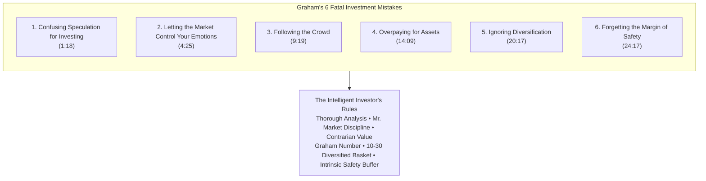
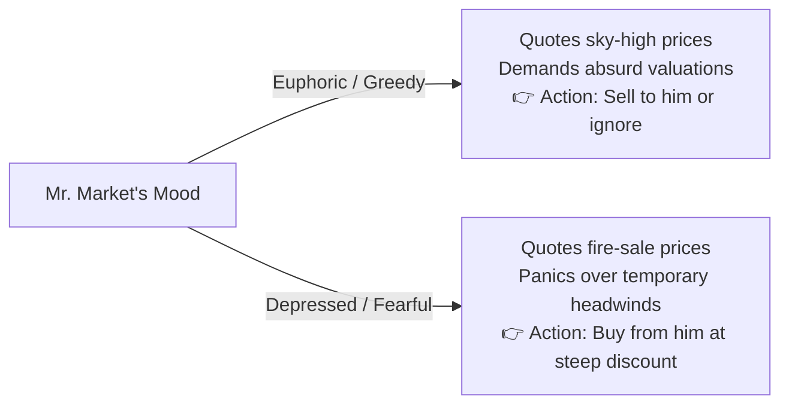
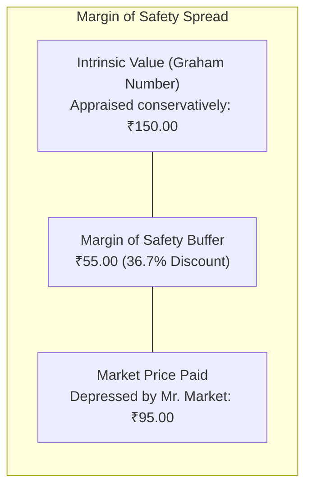
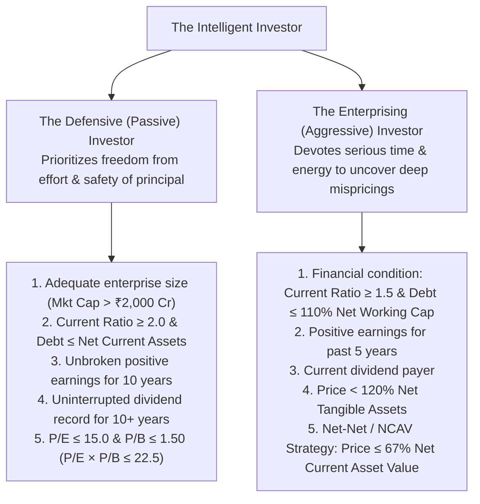
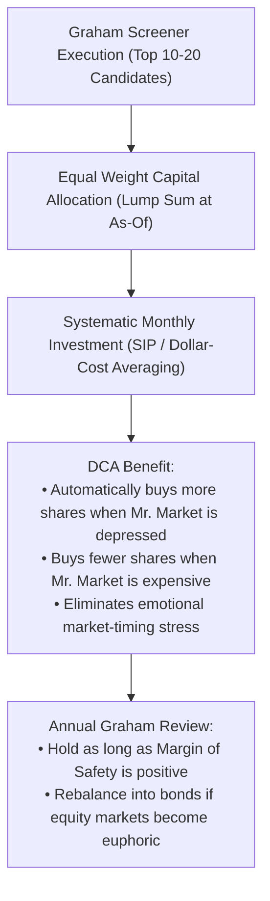
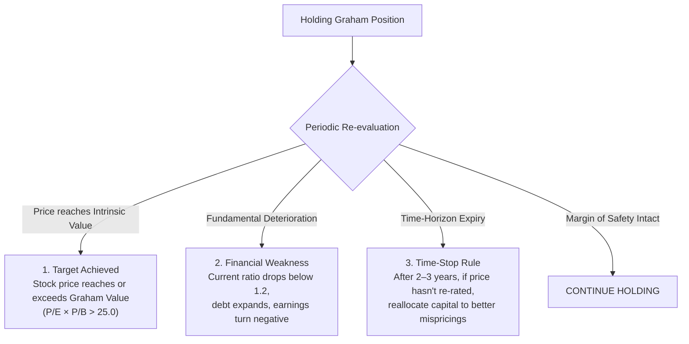

# The Intelligent Investor: Benjamin Graham's Quantitative Value Framework & Screener Architecture

---

## 1. Introduction: Benjamin Graham and Value Investing

Benjamin Graham (1894–1976), widely revered as the "Father of Value Investing" and mentor to Warren Buffett, laid the analytical foundation for modern equity research in *Security Analysis* (1934, with David Dodd) and distilled it for individual and professional investors in *The Intelligent Investor* (1949; revised 1973).

While contemporary markets are frequently dominated by narrative momentum, algorithmic high-frequency trading, and speculative excess, Graham’s core insight remains an enduring truth:

> **Graham's Axiom:**  
> *"In the short run, the market is a voting machine, but in the long run, it is a weighing machine."*  
> — Benjamin Graham, *The Intelligent Investor*

A share of stock is not an electronic lottery ticket or an abstract ticker symbol; it represents **proportional ownership of an operating business**. Over multi-year horizons, stock price convergence toward intrinsic value is mathematically guaranteed by dividends, cash generation, asset liquidation value, and earnings compounding.

---

## 2. Deconstructing the 6 Fatal Investment Mistakes

Graham's philosophy is fundamentally defensive: superior long-term performance is achieved not by chasing maximum returns during speculative bubbles, but by **eliminating catastrophic errors and permanent capital destruction**.



---

### 1:18 - Mistake #1: Confusing Speculation for Investing

> *"An investment operation is one which, upon thorough analysis promises safety of principal and an adequate return. Operations not meeting these requirements are speculative."*  
> — Benjamin Graham, *The Intelligent Investor*, Chapter 1

#### The Problem
Most market participants believe they are "investing" when they buy stocks based on chart patterns, popular rumors, social media euphoria, or futuristic growth projections. Graham categorized any operation lacking fundamental auditability as unhedged speculation:
- **Speculation:** Betting on the fluctuating price quotation of a security tomorrow, hoping another participant ("the greater fool") will pay a higher price.
- **Investing:** Purchasing an audited stream of earnings and tangible net assets at a measurable discount to their intrinsic worth.

#### The Quantitative Antidote
To ensure an operation qualifies as an **investment**, the quantitative screener strictly enforces:
1. **Audited Positive Earnings:** Trailing EPS $> 0$ and Net Income $> 0$ across multiple fiscal periods.
2. **Positive Tangible Net Worth:** Stockholders' Equity $> 0$ and tangible book value per share $> 0$.
3. **No Unbacked Blue-Sky Multiples:** Rejection of non-revenue or loss-making enterprises regardless of narrative momentum.

---

### 4:25 - Mistake #2: Letting the Market Control Your Emotions

> *"The investor's chief problem—and even his worst enemy—is likely to be himself."*  
> — Benjamin Graham, *The Intelligent Investor*, Chapter 8

#### The Allegory of Mr. Market
Graham created the legendary character of **Mr. Market**: an obliging business partner who knocks on your door every single trading day offering to buy your share of the business or sell you his share at a quoted price. 



- **The Fatal Flaw:** Novice investors treat Mr. Market as an authority who tells them what their assets are worth. When stock prices drop 30%, they panic and sell at the bottom.
- **The Intelligent Perspective:** Mr. Market is a servant, not a master. His quotations represent opportunities to transact, not judgments of intrinsic business value.

#### The Quantitative Antidote
- **Systematic Dollar-Cost Averaging (SIP):** Graham advocated allocating equal amounts of capital at fixed intervals (monthly/quarterly) regardless of headline sentiment. This guarantees buying more shares when Mr. Market is depressed and fewer shares when he is euphoric.
- **Price Near Valuation Trough:** Screening for companies trading near their 52-week low or at multi-year valuation discounts.

---

### 9:19 - Mistake #3: Following the Crowd

> *"You are neither right nor wrong because the crowd disagrees with you. You are right because your data and reasoning are right."*  
> — Benjamin Graham, *The Intelligent Investor*, Chapter 20

#### The Herd Psychology Trap
The herd instinct is hardwired into human psychology. Investors feel safe buying stocks that everyone else is buying—especially when headline media is glowing, brokers are issuing "Strong Buy" ratings, and prices have risen for 12 straight months. 

However, in financial markets, **consensus optimism is mathematically priced into the stock**:
- When everyone loves a stock, its P/E multiple expands to 50x–100x. Even a trivial earnings miss results in severe de-rating.
- Outstanding investment bargains are invariably found among **unpopular, neglected, or out-of-favor companies** that the crowd has temporarily abandoned.

#### The Quantitative Antidote
- **Contrarian Screening:** Screening unloved stocks trading at significant discounts to historical multiples and book values.
- **Institutional Neglect:** Targeting securities with moderate institutional ownership and absence of speculative trading volume.

---

### 14:09 - Mistake #4: Overpaying for Assets

> *"Even a great company is not a great investment if you pay too much for it."*  
> — Benjamin Graham, *The Intelligent Investor*, Chapters 14 & 15

#### The Cost of Valuation Blindness
A business can grow its earnings at 20% annually, yet inflict heavy losses on an investor who paid 80x earnings for it (as illustrated by the 2000 Dot-Com crash and the Nifty Fifty era of 1972). Overpaying eliminates the compounding power of the underlying business.

#### The Graham Valuation Formulae
Graham devised concrete arithmetic ceilings to prevent overpaying:

1. **The Maximum P/E Ceiling:**  
   $$\text{P/E} \le 15.0 \quad \text{(based on 3-year average earnings)}$$

2. **The Maximum P/B Ceiling:**  
   $$\text{P/B} \le 1.50 \quad \text{(based on latest tangible book value)}$$

3. **The Graham Multiplier Rule (P/E × P/B):**  
   To allow flexibility (e.g., a stock with a low P/E of 9x could justify a higher P/B of 2.5x), Graham established that the **product of P/E and P/B must not exceed 22.5**:
   $$\text{P/E} \times \text{P/B} \le 22.5 \quad (15.0 \times 1.50 = 22.50)$$

4. **The Graham Number (Intrinsic Value Upper Bound):**  
   Solving for price where $\frac{P}{\text{EPS}} \times \frac{P}{\text{BVPS}} = 22.5$:
   $$P^2 = 22.5 \times \text{EPS} \times \text{BVPS}$$
   $$\boxed{\text{Graham Number} = \sqrt{22.5 \times \text{EPS} \times \text{BVPS}}}$$
   An Intelligent Investor insists that $\text{Current Market Price} \le \text{Graham Number}$.

---

### 20:17 - Mistake #5: Ignoring Diversification

> *"Diversification is an established tenet of conservative investment."*  
> — Benjamin Graham, *The Intelligent Investor*, Chapters 3 & 14

#### The Idiosyncratic Risk Trap
Concentrated portfolios ("put all your eggs in one basket and watch that basket") work brilliantly in bull markets when speculative bets pay off, but lead to ruin when an unforeseen tail risk hits (e.g., regulatory ban, corporate accounting fraud, sudden key-man mortality, or technological obsolescence).

#### Graham's Portfolio Diversification Rules
1. **Portfolio Breadth:** Hold a minimum of **10 distinct issues** and a maximum of **30 distinct issues**.
2. **Sector Dispersion:** Avoid putting more than 20% of total capital into a single industry group.
3. **Equal or Conservative Weighting:** Allocate capital across qualifying issues equally, avoiding disproportionate bets on single high-conviction ideas.
4. **The 50/50 Equity-Debt Asset Allocation Balance:** Graham advocated maintaining between 25% and 75% in high-grade bonds/fixed deposits, with a 50/50 baseline, rebalancing when equity valuations reach extremes.

---

### 24:17 - Mistake #6: Forgetting the Margin of Safety

> *"Confronted with the challenge to distill the secret of sound investment into three words, we venture the motto: **MARGIN OF SAFETY**."*  
> — Benjamin Graham, *The Intelligent Investor*, Chapter 20

#### The Core Pillar of Value Investing
The **Margin of Safety** is the central concept of investment. It is the buffer between the price paid and the appraised intrinsic value of the enterprise.



#### Why the Margin of Safety is Essential:
1. **Protection Against Estimation Errors:** Future earnings forecasts are inherently fallible. A 30% discount ensures profitability even if future earnings turn out 20% lower than expected.
2. **Protection Against Bad Luck & Recessions:** A robust margin of safety absorbs macro shocks without triggering insolvency.
3. **The Engine of Asymmetric Upside:** If the company performs merely adequately, the closing of the valuation discount yields handsome returns. If the company excels, the return is extraordinary.

#### Solvency & Balance Sheet Margin of Safety
A stock is not cheap if it carries crippling debt. Graham insisted on structural solvency buffers:
- **Current Ratio:** $\text{Current Assets} / \text{Current Liabilities} \ge 2.0$ (for industrials; $\ge 1.5$ absolute minimum).
- **Debt to Working Capital:** Long-Term Debt $\le$ Net Current Assets ($\text{Current Assets} - \text{Current Liabilities}$).
- **Debt to Equity:** $\text{Debt-to-Equity} \le 0.50$ (ideally zero or net cash).

---

## 3. Investor Archetypes: Defensive vs. Enterprising

Graham divided value investors into two distinct operational profiles based on the amount of intelligent effort, time, and analytical discipline they wish to commit:



### 3.1 The Defensive (Passive) Investor Rules (Chapter 14)
Designed for individuals who want robust, above-average long-term results with minimal time expenditure:

| Rule | Quantitative Metric | Graham Specification | Modern Indian Market Benchmark |
| :--- | :--- | :--- | :--- |
| **1. Adequate Size** | Market Capitalization | Exclude small, unproven companies | Market Cap > ₹2,000 Cr (Mid-to-Large Cap) |
| **2. Financial Condition** | Current Ratio | Current Assets $\ge 2.0 \times$ Current Liabilities | Current Ratio $\ge 1.50 - 2.00$ |
| **2. Financial Condition** | Debt Coverage | Long-term debt $\le$ Net Current Assets | Debt-to-Equity $\le 0.50$; Interest Coverage $\ge 4.0$ |
| **3. Earnings Stability** | Profit Consistency | Some positive earnings for 10 consecutive years | Positive Net Profit for past 5–10 years |
| **4. Dividend Record** | Payout History | Uninterrupted dividends for past 20 years | Continuous annual dividend payments for past 5+ years |
| **5. Earnings Growth** | 10-Year Growth | Minimum 33% increase in EPS over 10 years | Positive 3Y/5Y EPS CAGR ($\ge 8\% - 10\%$) |
| **6. Moderate P/E** | Valuation Multiple | $\text{P/E} \le 15.0$ (on 3Y average earnings) | Trailing $\text{P/E} \le 15.0 - 18.0$ |
| **7. Moderate P/B** | Book Value Multiple | $\text{P/B} \le 1.50$ (or $\text{P/E} \times \text{P/B} \le 22.5$) | $\text{P/B} \le 1.50$ (or Graham Product $\le 22.5$) |

---

### 3.2 The Enterprising (Active) Investor Rules (Chapter 15)
Designed for analytical practitioners willing to inspect financial statements deeply:

1. **Financial Strength:** Current Assets $\ge 1.5 \times$ Current Liabilities; Long-Term Debt $\le 110\%$ of Net Working Capital.
2. **Earnings Record:** No deficit in earnings over the last 5 years.
3. **Dividend Payment:** Company currently pays an annual dividend.
4. **Price Relative to Past Earnings:** Price $< 15\times$ average 5-year earnings.
5. **Price Relative to Net Tangible Assets:** Price $< 120\%$ of Net Tangible Assets.
6. **The Net-Net Strategy (Net Current Asset Value - NCAV):**  
   Graham’s most profitable historical strategy:
   $$\text{NCAV} = \text{Current Assets} - \text{Total Liabilities} - \text{Preferred Stock}$$
   $$\text{Net-Net Buy Rule}: \quad \text{Price} \le \frac{2}{3} \times \text{NCAV per share}$$
   Purchasing a stock where cash, receivables, and inventory alone—after subtracting *all* debt and liabilities—exceed the total enterprise market capitalization by 50%. The fixed assets, plant, machinery, brand, and goodwill are acquired for free.

---

## 4. The Mathematical Formulas of Benjamin Graham

### 4.1 The Graham Multiplier & Graham Number
$$\text{Graham Multiplier} = \left(\frac{P}{\text{EPS}}\right) \times \left(\frac{P}{\text{BVPS}}\right) = \text{P/E} \times \text{P/B} \le 22.5$$

$$\boxed{\text{Graham Number} = \sqrt{22.5 \times \text{EPS} \times \text{BVPS}}}$$

Where:
- $\text{EPS} = \frac{\text{Net Income}}{\text{Diluted Weighted Average Shares}}$ (must be $> 0$).
- $\text{BVPS} = \frac{\text{Stockholders' Equity} - \text{Preferred Equity}}{\text{Diluted Weighted Average Shares}}$ (must be $> 0$).

### 4.2 Graham Margin of Safety Percentage
$$\boxed{\text{Margin of Safety (\%)} = \frac{\text{Graham Number} - \text{Current Market Price}}{\text{Graham Number}} \times 100}$$

- **Positive Margin of Safety ($> 0\%$):** Stock trades at a discount to Graham Value.
- **High Margin of Safety ($\ge 25\% - 35\%$):** Prime Graham investment candidate.
- **Negative Margin of Safety ($< 0\%$):** Overpriced under Graham criteria.

### 4.3 Net Current Asset Value (NCAV / Net-Net)
$$\boxed{\text{NCAV per Share} = \frac{\text{Current Assets} - \text{Total Liabilities}}{\text{Total Shares Outstanding}}}$$

$$\text{NCAV Margin of Safety (\%)} = \frac{\text{NCAV per Share} - \text{Price}}{\text{NCAV per Share}} \times 100$$

---

## 5. Screener Implementations

### 5.1 Screener.in Exact Query Syntax (Defensive Investor)
Paste this query into [Screener.in Custom Query](https://www.screener.in/create/):

```sql
Market Capitalization > 2000 AND
Price to Earning < 18 AND
Price to book value < 1.8 AND
Price to Earning * Price to book value < 22.5 AND
Current ratio > 1.5 AND
Debt to equity < 0.5 AND
Interest Coverage > 4 AND
Dividend yield > 1.0 AND
Return on equity > 12 AND
Return on capital employed > 15 AND
Pledged percentage < 1 AND
Cash from operations last year > 0
```

### 5.2 Screener.in Exact Query Syntax (Enterprising Investor)
```sql
Market Capitalization > 500 AND
Price to Earning < 20 AND
Price to book value < 2.0 AND
Price to Earning * Price to book value < 25.0 AND
Current ratio > 1.2 AND
Debt to equity < 1.0 AND
Return on capital employed > 10 AND
Pledged percentage < 2 AND
Cash from operations last year > 0
```

### 5.3 Screener.in Exact Query Syntax (Graham Net-Net & Deep Asset Value)

> [!NOTE]
> On **Screener.in**, `Total liabilities` is **not** a valid keyword. Screener.in provides a dedicated built-in metric **`NCAVPS`** (Net Current Asset Value Per Share). Alternatively, balance-sheet liabilities are decomposed into `Borrowings` (or `Debt`) and `Current liabilities` (or through `Working capital = Current assets - Current liabilities`).

#### Option A: Direct Screener.in Query Using Built-in `NCAVPS` (Recommended)
```sql
Current price < NCAVPS AND
Debt to equity < 0.5 AND
Cash from operations last year > 0 AND
Current ratio > 1.2
```

#### Option B: Strict Graham 2/3rd Net-Net (33% Margin of Safety to NCAV)
```sql
Current price < 0.67 * NCAVPS AND
Debt to equity < 0.5 AND
Cash from operations last year > 0
```

#### Option C: Manual Balance Sheet Aggregation (Without NCAVPS)
```sql
Market Capitalization < (Current assets - Current liabilities - Borrowings) AND
Cash from operations last year > 0 AND
Debt to equity < 0.5 AND
Current ratio > 1.2
```
*(Or equivalently using Working Capital: `Market Capitalization < (Working capital - Borrowings) AND Cash from operations last year > 0`)*

---

### 5.4 Honba Tier 1 Grammar Query (Defensive & Net-Net)

#### Graham Defensive Investor:
```text
market_cap > 20000000000 AND
pe_ratio > 0 AND pe_ratio <= 18.0 AND
pb_ratio > 0 AND pb_ratio <= 1.80 AND
pe_ratio * pb_ratio <= 22.5 AND
current_ratio >= 1.50 AND
debt_to_equity <= 0.50 AND
interest_coverage >= 4.0 AND
dividend_yield >= 1.0 AND
cfo_to_pat_3y >= 0.70 AND
promoter_pledge <= 1.0
```

#### Graham Net-Net (NCAV) Filter:
```text
current_assets > total_liabilities AND
price <= 1.0 * ncav_per_share AND
current_ratio >= 1.50 AND
debt_to_equity <= 0.50 AND
operating_cash_flow_3y > 0 AND
promoter_pledge <= 1.0
```

---

## 6. Portfolio Construction & The Systematic Dollar-Cost Averaging Discipline

Even the most rigorous value screener will underperform if portfolio execution violates Graham's structural directives:



### The In-Sample Screening & Out-of-Sample SIP Confirmation Architecture
To backtest and validate an Intelligent Investor strategy on historical market data:
1. **In-Sample Horizon ($t_{\text{start}}$ to $t_{\text{asof}}$):**
   - Screen candidates strictly using financial statements and prices available on or before $t_{\text{asof}}$.
   - Compute Point-in-Time EPS, BVPS, Graham Value, and Margin of Safety.
   - Select the Top $N$ candidates possessing the largest Margin of Safety.
   - Allocate initial capital equally across all $N$ stocks.
2. **Out-of-Sample Horizon ($t_{\text{asof}}$ to $t_{\text{today}}$):**
   - Execute monthly SIP installments divided equally across the portfolio.
   - Track portfolio performance using institutional metrics:
     - **Lump Multiplier:** Initial capital terminal multiple.
     - **SIP Multiplier:** Dollar-cost averaged capital terminal multiple.
     - **Peak Multiplier:** Highest intra-period valuation multiple achieved.
     - **Annualized Portfolio XIRR:** True internal rate of return accounting for cash flow timing.

---

## 7. When to Sell Under Graham's Discipline

Graham established strict rules for exiting an investment to avoid turning into an involuntary "buy and hold forever" speculator:



1. **Target Price Reached:** The stock price has advanced to its full intrinsic value (e.g., $\text{Price} \ge \text{Graham Number}$ or $\text{P/E} \times \text{P/B} > 25$). Take profits and redeploy capital into newly undervalued securities.
2. **Deterioration of Financial Condition:** Working capital weakens, current ratio falls below 1.2, or long-term debt expands significantly.
3. **The 2-to-3-Year Time Rule:** If an undervalued stock has failed to re-rate after 2 to 3 years despite stable operations, reallocate the capital to more promising opportunities.

---

## 8. Summary Comparison: Multibagger vs. Intelligent Investor

| Investment Dimension | Prospective Multibagger (Growth / Momentum) | The Intelligent Investor (Graham Value) |
| :--- | :--- | :--- |
| **Primary Driver** | Earnings acceleration + P/E multiple expansion | Deep discount to asset value + mean reversion |
| **Typical Valuation** | P/E 20x–45x; PEG < 1.5; Price near 52-week High | P/E < 15x; P/B < 1.5x; $\text{P/E} \times \text{P/B} \le 22.5$; near 52-week Low |
| **Balance Sheet Anchor**| High ROCE (> 20%) & high reinvestment rate | High Current Ratio ($\ge 2.0$), Low Debt-to-Equity ($\le 0.5$) |
| **Market Catalyst** | Stage 2 volume breakout, institutional discovery | Mr. Market overreaction, temporary bad news, neglected value |
| **Downside Protection** | Operational growth runway & competitive moat | Balance sheet margin of safety & tangible net assets |
| **Psychological Focus** | Riding winners through 30%–50% volatility tax | Emotional detachment from Mr. Market & dollar-cost averaging |

---

## 9. Comprehensive Bibliography & References

1. **Graham, Benjamin.** *The Intelligent Investor: The Definitive Book on Value Investing*. New York: Harper & Row, 1949; 4th rev. ed. with commentary by Jason Zweig, New York: HarperBusiness Essentials, 2003.  
   *(The definitive manual covering the Defensive vs Enterprising investor, the allegory of Mr. Market, and Chapter 20 on the Margin of Safety).*
2. **Graham, Benjamin, and David L. Dodd.** *Security Analysis: Principles and Technique*. New York: McGraw-Hill, 1934; 6th ed. with commentary by Seth Klarman et al., New York: McGraw-Hill, 2008.  
   *(The foundational textbook establishing balance sheet analysis, NCAV net-net valuation, and earnings power value).*
3. **Buffett, Warren E.** "The Superinvestors of Graham-and-Doddsville." *Hermes: Columbia Business School Magazine*, 1984, pp. 4–15.  
   *(Empirical proof that disciples of Benjamin Graham—including Walter Schloss, Tom Knapp, Bill Ruane, and Charlie Munger—consistently beat market benchmarks over multi-decade careers without taking higher beta risk).*
4. **Schloss, Walter J.** "Factors in Choosing Common Stocks." *Speech at Harvard Business School*, 1989.  
   *(Detailed implementation of Graham's Net-Net and deep asset-based value strategy, compounding at 21% annually over 47 years).*
5. **Klarman, Seth A.** *Margin of Safety: Risk-Averse Value Investing Strategies for the Thoughtful Investor*. New York: HarperCollins, 1991.  
   *(Modern institutional application of Graham's margin of safety to distressed debt, spin-offs, and value investing).*
6. **Greenblatt, Joel.** *The Little Book That Still Beats the Market*. Hoboken, NJ: John Wiley & Sons, 2010.  
   *(Combines Graham's value metric [Earnings Yield] with modern quality [Return on Capital] into the Magic Formula).*
7. **Carlisle, Tobias E.** *Deep Value: Why Activist Investors and Other Contrarians Battle for Control of Losing Corporations*. Hoboken, NJ: John Wiley & Sons, 2014.  
   *(Empirical research backtesting Graham's Net-Net / NCAV strategies across 40 years of market data).*
8. **Fama, Eugene F., and Kenneth R. French.** (1992). "The Cross-Section of Expected Stock Returns." *The Journal of Finance*, 47(2), 427–465.  
   *(Academic validation of Graham's low P/B and low P/E value premium over 50 years of empirical market cycles).*
