# Multibagger Stocks and Identification: The Indian Market Consensus Framework

---

## 1. Introduction: The Anatomy of a Multibagger

A **multibagger**—a term popularized by legendary investor Peter Lynch in *One Up on Wall Street* (1989)—refers to an equity investment that multiplies its purchase price by several times (e.g., a "10-bagger" generates a 10x return or +900%; a "100-bagger" yields 100x or +9,900%).

In the Indian equity markets (NSE/BSE), where nominal GDP compounds at 10–12% (6–7% real GDP + 4–5% consumer inflation) and an enormous unorganized economy continuously cedes market share to compliant, formal entities, multibaggers are not random statistical anomalies. They are systematic, identifiable outcomes produced by structural compounding engines.

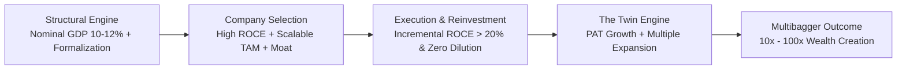

Between 2000 and 2025, the Indian market generated over 500 ten-baggers and more than 70 hundred-baggers across sectors as diverse as chemicals (PI Industries, Atul), consumer durables (Havells, Titan, Astral), finance (Bajaj Finance, Chola Finance), and capital goods (Uno Minda, Supreme Industries). Identifying these compounders early requires a synthesis of quantitative rigor, forensic skepticism, and structural market cycle understanding.

---

## 2. Growth, Quality of Growth, and Re-Rating: The "Twin-Engine" Principle

Over multi-year horizons, equity market returns are mathematically governed by an immutable algebraic relationship:

$$P_t = \text{EPS}_t \times (P/E)_t$$

$$\text{Total Return} = \frac{P_t}{P_0} - 1 = \left(1 + g_{\text{EPS}}\right)^t \times \left(\frac{(P/E)_t}{(P/E)_0}\right) - 1$$

Multibagger returns originate along three distinct pathways:

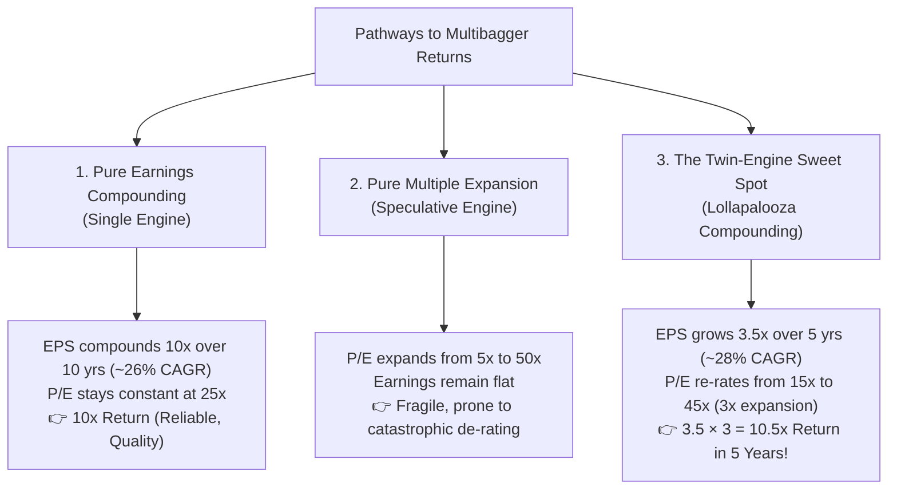

### 2.1 Engine 1: Growth in Net Earnings (PAT)
- **High Incremental ROCE:** Pure volume or revenue growth without capital efficiency destroys economic value. Sustainable PAT growth requires an Incremental Return on Capital Employed (Incremental ROCE) substantially exceeding the Weighted Average Cost of Capital (WACC):
  $$\text{Reinvestment Rate} = \frac{\text{Capex} + \Delta\text{Working Capital} - \text{Depreciation}}{\text{NOPAT}}$$
  $$g = \text{Reinvestment Rate} \times \text{ROCE}$$
  When ROCE is 30%, a business needs to reinvest only 50% of its operating profit to achieve a 15% secular growth rate, leaving the remaining 50% as Free Cash Flow (FCF) for dividend distributions or strategic runway.
- **Volume vs. Price-Driven Growth:** High-conviction multibaggers drive earnings through volume market-share capture and operating leverage, rather than raw commodity price spikes that inevitably mean-revert.

### 2.2 Engine 2: Valuation Re-Rating (P/E Expansion)
Valuation multiples expand when the consensus market narrative shifts positively across four structural dimensions:
1. **Capitalization Migration (Discovery Effect):** The stock ascends from small-cap obscurity (< ₹3,000 Cr) with minimal institutional coverage to mid-cap prominence (> ₹15,000 Cr), triggering index inclusion, mutual fund mandate buying, and foreign portfolio investor (FPI) tracking.
2. **Business Model Reclassification:** The market ceases valuing the firm as a cyclical B2B vendor (e.g., 10–12x P/E) and reclassifies it as a branded, sticky, high-margin consumer or mission-critical enterprise (35–50x P/E).
3. **Governance De-risking:** Resolution of historical promoter opacity, elimination of debt, cancellation of promoter pledging, or appointment of Big-4 statutory auditors eliminates the "conglomerate/governance discount."
4. **Earnings Longevity Visibility:** When a firm expands its order book visibility from 1 year to 5–7 years, investors lengthen their Discounted Cash Flow (DCF) horizons, directly driving multiple expansion.

When Engine 1 (PAT doubling or tripling) operates simultaneously with Engine 2 (P/E tripling), returns multiply geometrically—a classic Charlie Munger *Lollapalooza Effect*.

---

## 3. Core Frameworks from Legendary Indian Investors

Decades of wealth creation across Indian equity market cycles—the 1990s post-liberalization wave, the 2003–2008 capital goods/infrastructure super-cycle, the 2010–2020 consumer/private lending decade, and the 2020+ manufacturing/energy/defence renaissance—have produced distinct investment frameworks formulated by India's preeminent allocators.

### 3.1 Motilal Oswal / Raamdeo Agrawal: The S-QGLP Framework
Developed across 30+ annual Motilal Oswal Wealth Creation Studies (1996–2025) by Raamdeo Agrawal, the **S-QGLP** architecture represents the most thoroughly backtested framework in Indian capital markets:

| Pillar | Criterion | Indian Market Quantitative Benchmark |
| :--- | :--- | :--- |
| **S — Size** | Low Base Effect | Market Cap between ₹1,000 Cr and ₹25,000 Cr. A ₹10 Lakh Cr megacap cannot multiply 10x–100x within a decade without exceeding total domestic GDP constraints. |
| **Q — Quality** | Business Moat & Management | **Business Quality:** Sustained ROCE > 20%, ROE > 18%, net debt-free, Free Cash Flow to PAT > 70%.<br/>**Management Quality:** Unquestioned integrity, capital allocation discipline, promoter skin in the game (> 50% equity stake, zero pledge). |
| **G — Growth** | Earnings Compounding | PAT CAGR ≥ 20–25%. Volume-led expansion, pricing power, and scalable addressable market. |
| **L — Longevity** | Durability of Competitive Edge | Competitive moat (distribution, cost leadership, network effects) lasting 10–20 years. Capitalizing on structural *Value Migration* (e.g., state-owned to private enterprise; unbranded to branded). |
| **P — Price** | Margin of Safety | Favorable entry valuation. PEG Ratio ≤ 1.0–1.3. **Payback Ratio** < 1.0 (defined as: $\text{Current Market Cap} / \text{Cumulative Projected 5-Year PAT}$). |

> [!NOTE]
> In the 19th Motilal Oswal Wealth Creation Study (2014, *100x: The Science of 100-Baggers*), Agrawal demonstrated that 100-baggers in India required an average of 12.3 years to materialize, compounding at a median CAGR of 45%. In 90% of cases, earnings growth accounted for roughly 60% of total returns, while valuation re-rating contributed the remaining 40%.

---

### 3.2 Vijay Kedia: The SMILE & RISE Framework
Coined by veteran investor Vijay Kedia (who captured 100-baggers in Atul Auto, Cera Sanitaryware, and Aegis Logistics):

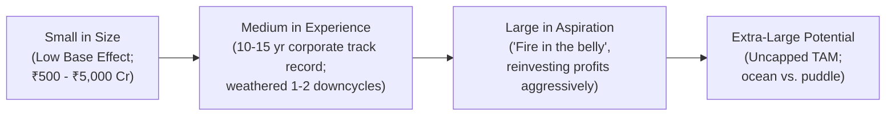

#### The SMILE Philosophy
- **S (Small in Size):** Low initial market cap (₹500 Cr to ₹5,000 Cr) providing vast room for multi-fold expansion before institutional saturation.
- **M (Medium in Experience):** Explicitly avoid zero-track-record startups and freshly minted, euphoric IPOs. Target firms with 10–20 years of operational survival that have endured at least one brutal industry downturn (e.g., 2008 GFC, 2013 taper tantrum, or 2016 demonetization).
- **I / L (Large in Aspiration):** Promoters with fierce operational hunger, ethical ambition, and capital discipline who prioritize business scale over personal cash extraction.
- **E (Extra-large in Market Potential):** Massive Total Addressable Market (TAM). A brilliant management team trapped in a ₹500 Cr total industry pool cannot create a multibagger.

#### The RISE Sectoral Matrix
Combine micro SMILE company selection with **RISE** macroeconomic tailwinds:
- **R — Renewables & Energy Transition:** Solar balance-of-plant, battery supply chain, green hydrogen, transmission grids.
- **I — Infrastructure & Logistics:** Express logistics, dedicated freight corridors, port infrastructure, industrial warehousing.
- **S — Security, Defence, & Capital Goods:** Indigenous defence equipment, specialized machining, aerospace components.
- **E — Emerging Technologies & Manufacturing:** Electronics System Design & Manufacturing (ESDM), precision robotics, high-purity chemical synthesis.

---

### 3.3 Kenneth Andrade: The Capital Cycle (Supply-Side Framework)
Formulated by Kenneth Andrade (Founder of Old Bridge Capital Management; former CIO of IDFC Mutual Fund):

```mermaid
stateDiagram-v2
    [*] --> IndustryBoom : High Demand & Surging Margins
    IndustryBoom --> ExcessiveCapex : Competitors flood market with debt-fueled capacity
    ExcessiveCapex --> IndustryOversupply : Supply exceeds demand; prices collapse
    IndustryOversupply --> Shakeout : Marginal firms go bankrupt; capex freezes
    Shakeout --> SurvivorsAdvantage : 1-2 debt-free players absorb capacity at trough
    SurvivorsAdvantage --> MultibaggerInflection : Demand normalizes; prices soar; ROCE explodes
    MultibaggerInflection --> IndustryBoom
```

- **Supply-Side Predictability:** Forecasting end-consumer demand over 5 years is notoriously unreliable; **tracking industry capex and capacity additions on the supply side is concrete and observable**.
- **The Capital Cycle Trough:** Peak wealth creation occurs when an industry has suffered a multi-year bear market: capital expenditure has ground to zero, industry capacity utilization is depressed, and leveraged competitors are entering bankruptcy or debt restructuring.
- **The Survivor's Asymmetric Payoff:** Locate the 1 or 2 efficient operators possessing pristine, debt-free balance sheets. When macroeconomic demand recovers even moderately:
  1. No new supply can arrive for 2–3 years (due to construction lead times).
  2. The survivor captures pricing power, driving astronomical ROCE expansion.
  3. Operating cash flows explode, triggering a massive valuation re-rating.

---

### 3.4 Basant Maheshwari: Secular High-ROCE Compounders
Author of *The Thoughtful Investor*, Maheshwari focuses on retail and consumer franchises characterized by persistent, non-cyclical compounding:
- **The Flywheel Hurdle:** Minimum threshold of **Sales CAGR ≥ 25%** coupled with **ROCE ≥ 30%** sustained over rolling 5-year cycles.
- **The Non-Dilution Mandate:** A business earning a 30% ROCE can finance 25% annual top-line growth entirely out of internal cash generation without needing equity dilution or debt issuances.
- **The "Scarcity Premium" Principle:** In an emerging economy where capital is scarce and cyclical volatility is high, businesses offering predictable, non-cyclical 25%+ earnings growth deserve—and permanently command—elevated valuation multiples (P/E 40x–60x). Trimming them simply because they appear "statistically expensive" is an investor's costliest mistake.

---

### 3.5 Saurabh Mukherjea (Marcellus): Coffee Can Investing & Forensic Discipline
Synthesizing Robert Kirby’s original 1984 Coffee Can concept with Howard Schilit’s forensic accounting frameworks, Saurabh Mukherjea (*Coffee Can Investing*, *The Unusual Billionaires*, *Diamonds in the Dust*) established institutional filters for long-term Indian compounders:

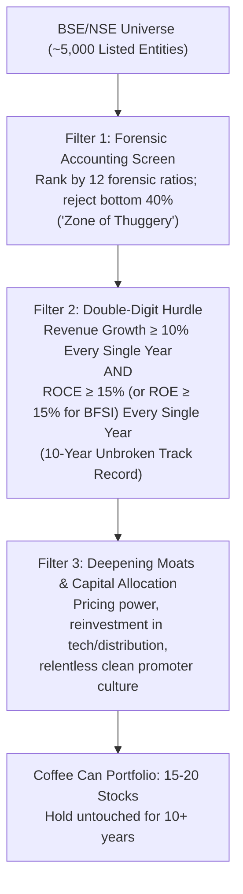

#### The Quantitative Double-Digit Hurdle
- **Non-Financials:** Minimum **10% Sales Growth** AND **15% ROCE** in *each and every year* over a consecutive 10-year rolling window.
- **Financials (Banks & NBFCs):** Minimum **15% Loan Book Growth** AND **15% ROE** with Gross NPA consistently < 2.0% across complete credit cycles.

#### Deepening Moats & Reinvestment
A firm clearing these hurdles possesses structural advantages:
- Unmatched supply chain efficiencies (e.g., Asian Paints' direct-to-dealer network bypassing wholesalers).
- Scale-driven procurement economics (e.g., Astral's resin sourcing advantage).
- Intangible brand trust and switching costs (e.g., Pidilite’s carpenter mindshare, Titan’s consumer gold purity perception).

---

## 4. Indian Structural Tailwinds: Where Multibaggers Breed

Unlike saturated developed markets, the Indian economy undergoes multi-decade tectonic shifts that fuel corporate earnings far in excess of headline GDP:

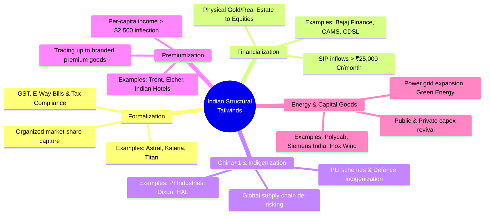

### Empirical Case Studies of Indian Structural Winners

| Structural Tailwind | Representative 10x–100x Multibaggers | Key Fundamental Catalyst |
| :--- | :--- | :--- |
| **Formalization** | **Astral Ltd** (Plumbing Pipes)<br/>**Kajaria Ceramics** (Tiles)<br/>**Titan Company** (Jewelry) | Implementation of GST and electronic invoice cross-matching crippled unorganized tax-evading rivals, channeling 30–50% market share to compliant brand leaders. |
| **Financialization** | **Bajaj Finance** (Consumer Credit)<br/>**CDSL** (Depository)<br/>**CAMS** (RTA Platform) | Demat accounts expanded from 4 Cr (2020) to 18+ Cr (2025). Monthly SIP flows crossed ₹25,000 Cr, creating permanent domestic liquidity and fee income streams. |
| **China+1 & Manufacturing** | **PI Industries** (Agrochem/CSM)<br/>**Dixon Technologies** (EMS)<br/>**Uno Minda** (Auto Components) | Multinational corporations diversified supply chains away from China; Government of India PLI (Production Linked Incentive) schemes subsidized domestic manufacturing. |
| **Premiumization** | **Trent Ltd** (Fast Fashion/Zudio)<br/>**Eicher Motors** (Royal Enfield)<br/>**Indian Hotels** (Luxury Hospitality) | Indian GDP per capita crossing the $2,500 threshold unlocked an exponential inflection in discretionary consumer expenditure and branded aspiration. |
| **Energy & Capex Revival** | **Polycab India** (Cables & Wires)<br/>**Inox Wind / Suzlon** (Renewables)<br/>**Cummins India** (Power Generation) | Renewable energy transmission upgrades, industrial real estate construction, data center electrification, and domestic infrastructure modernization. |

---

## 5. Forensic Accounting: The Indian Market "Zone of Thuggery" Filter

In Indian small-cap and mid-cap investing, the risk of corporate fraud and balance sheet manipulation far outweighs valuation risk. Identifying a prospective multibagger requires rigorous forensic due diligence to eliminate companies residing in what Saurabh Mukherjea terms the **"Zone of Thuggery."**

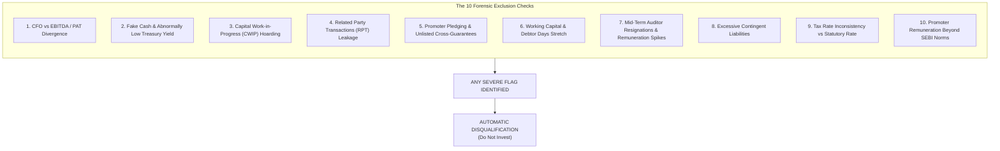

### Critical Forensic Red Flags & Mathematical Checks

#### 1. Operating Cash Flow (CFO) vs. Net Profit (PAT) Divergence
- **The Metric:** Cumulative 5-Year Cash Flow from Operations ($\sum \text{CFO}_{5Y}$) divided by Cumulative 5-Year Net Profit ($\sum \text{PAT}_{5Y}$).
- **Threshold:** $\frac{\sum \text{CFO}_{5Y}}{\sum \text{PAT}_{5Y}} \ge 0.75 - 0.80$.
- **Red Flag:** Growing accounting profits accompanied by flat or negative operating cash flows indicate aggressive revenue recognition, fictitious invoice booking, or uncollectible receivables.

#### 2. The "Fake Cash" Check (Treasury Yield Sanity)
- **The Metric:** Effective Yield on Cash = $\frac{\text{Other Income (Interest / Dividend)}}{\text{Average Cash \& Bank Balances + Short-Term Liquid Investments}}$.
- **Threshold:** The yield must align within 100–150 bps of prevailing commercial fixed deposit (FD) or RBI repo rates (typically 6.0%–7.5%).
- **Red Flag:** Yields below 3–4% imply that the cash reported on the balance sheet is fictitious or encumbered as undeclared collateral for unlisted promoter entity borrowings (historical examples: Satyam Computer Services, Cox & Kings).

#### 3. Capital Work-in-Progress (CWIP) as % of Gross Block
- **The Metric:** $\frac{\text{CWIP}}{\text{Gross Block}}$.
- **Threshold:** Must be $< 20\%$ unless verified greenfield plants are actively under construction.
- **Red Flag:** High CWIP lingering on the books for > 2–3 consecutive years without commercialization. Fraudulent managements capitalize regular operational expenses (salaries, interest, repairs) into CWIP to artificially suppress P&L expenses and inflate reported EBITDA.

#### 4. Working Capital & Debtor Days Distortion
- **The Metric:** Receivables Growth Rate vs. Revenue Growth Rate, and Debtor Days ($\frac{\text{Trade Receivables}}{\text{Revenue}} \times 365$).
- **Red Flag:** Trade receivables growing at more than 1.5x the rate of revenue growth, or Debtor Days expanding by > 30 days within two financial years, indicates channel stuffing or fabricated credit sales.

#### 5. Related Party Transactions (RPT) & Loans to Group Entities
- **The Metric:** Total value of loans, advances, guarantees, and business transactions with entities owned by promoters or their relatives as a percentage of Net Worth.
- **Red Flag:** Material loans or advances granted to unlisted promoter subsidiaries or related shell entities. In Indian micro-caps, this is the primary mechanism for siphoning IPO or operational capital out of the listed entity (e.g., DHFL, Manpasand Beverages).

#### 6. Auditor Quality, Turnover, and Fee Disparity
- **Red Flag:** Mid-term auditor resignations, especially occurring in Q3 or Q4 shortly before annual audited filings, citing "preoccupation" or "commercial disagreements."
- **Red Flag:** Appointment of small, local, two-partner audit firms for enterprises boasting market capitalizations exceeding ₹2,000 Cr.
- **Red Flag:** Auditor remuneration growing at 3x–5x the rate of top-line revenue growth without significant geographic or subsidiary expansion.

#### 7. Promoter Pledging & Unlisted Corporate Guarantees
- **The Metric:** Pledged Shares as % of Total Promoter Equity Holding.
- **Threshold:** Ideal = $0.0\%$; Absolute Maximum Tolerable = $< 2.0\%$.
- **Red Flag:** Pledged shares $> 10\%$. Pledging creates severe downside convexity: during market downturns, lenders invoke margin calls and liquidate collateralized promoter shares, triggering vicious downward limit-circuits (e.g., Zee Entertainment, Reliance Infra).

#### 8. Contingent Liabilities vs. Net Worth
- **The Metric:** $\frac{\text{Contingent Liabilities}}{\text{Net Worth}}$.
- **Threshold:** $< 15\% - 20\%$.
- **Red Flag:** Contingent liabilities exceeding 30–40% of Net Worth, driven by tax dispute guarantees, unhedged foreign exchange exposures, or corporate guarantees extended to third-party group ventures.

#### 9. Effective Tax Rate Sanity
- **The Metric:** $\text{Effective Tax Rate} = \frac{\text{Tax Expense}}{\text{Profit Before Tax (PBT)}}$.
- **Threshold:** Should align closely with statutory corporate tax rates (approximately 25.17% in India following the 2019 corporate tax reform, or 17.16% for eligible new manufacturing units).
- **Red Flag:** Persistent effective tax rates $< 15\%$ in the absence of valid SEZ / Section 115BAA tax holidays. Companies reporting booming book profits while paying negligible corporate tax frequently display fraudulent accounting earnings.

#### 10. Managerial Remuneration Ceilings
- **The Metric:** Total Executive Director & Promoter Remuneration as % of Net Profit.
- **Threshold:** Must comply with Section 197 of the Companies Act, 2013 (< 5% of net profit for a single managing director; < 10% for all managerial personnel combined).
- **Red Flag:** Promoters drawing the legal statutory maximum salary while the business pays negligible dividends and free cash flows remain negative.

---

## 6. Actionable Quantitative Screening Checklist

The consensus screening architecture synthesizes Growth, Quality, Capital Efficiency, Governance, and Valuation into a prioritized 6-stage quantitative funnel:

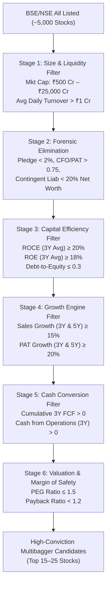

### The Multibagger Quantitative Funnel Specification

| Stage | Metric Name | Minimum Threshold | Ideal / High-Conviction | Rationale |
| :--- | :--- | :--- | :--- | :--- |
| **1. Base Size** | Market Capitalization | ₹500 Cr – ₹25,000 Cr | ₹1,500 Cr – ₹12,000 Cr | Sweet spot for institution-driven discovery and 5x–20x expansion room. |
| **1. Base Size** | Average Daily Turnover | > ₹1.0 Cr | > ₹3.0 Cr | Ensures liquidity for position sizing without prohibitive price impact. |
| **2. Forensic** | Promoter Pledge % | ≤ 2.0% | **0.0%** | Protects against margin-call cascades and distress liquidations. |
| **2. Forensic** | Contingent Liabilities / Net Worth | ≤ 20.0% | ≤ 10.0% | Prevents hidden off-balance sheet claims from destroying equity value. |
| **2. Forensic** | CWIP / Gross Block | ≤ 25.0% | ≤ 15.0% | Prevents hidden operational expense capitalization. |
| **3. Capital Efficiency** | ROCE (3-Year Average) | ≥ 18.0% | ≥ 25.0% | Verifies core economic moat and internal value generation. |
| **3. Capital Efficiency** | ROE (3-Year Average) | ≥ 15.0% | ≥ 20.0% | Ensures shareholder equity returns beat risk-free rates by a wide margin. |
| **3. Capital Efficiency** | Debt to Equity Ratio | ≤ 0.50 | ≤ 0.20 (or Net Cash) | Low financial risk ensures survival through unexpected credit crunches. |
| **3. Capital Efficiency** | Interest Coverage Ratio | ≥ 4.0x | ≥ 8.0x | Comfortably covers interest costs even during deep industry downturns. |
| **4. Growth** | Sales Growth (3Y & 5Y CAGR) | ≥ 15.0% | ≥ 22.0% | Real volume expansion and market share capture. |
| **4. Growth** | PAT Growth (3Y & 5Y CAGR) | ≥ 18.0% | ≥ 25.0% | Operating leverage converting top-line growth into expanded profits. |
| **5. Cash Flows** | Cumulative CFO / Cumulative PAT (3Y) | ≥ 75.0% | ≥ 90.0% | Verifies reported accounting profits are converted to hard liquid cash. |
| **5. Cash Flows** | Free Cash Flow (3Y Cumulative) | > ₹0 | Strongly Positive | Confirms business funds growth investments without external debt. |
| **6. Valuation** | PEG Ratio (Trailing P/E / 3Y PAT Growth) | ≤ 1.50 | ≤ 1.00 | Prevents overpaying for growth, ensuring margin of safety. |

---

## 7. Screener Implementations

### 7.1 Screener.in Exact Query Syntax
Paste this query directly into the [Screener.in Custom Query Builder](https://www.screener.in/create/):

> [!NOTE]
> **Screener.in Variable Syntax Nuances:**  
> In Screener.in's SQL engine, cumulative multi-year operating cash flow is represented by `Operating cash flow 3years` and `Operating cash flow 5years`. The phrase `Cash from operations` is strictly reserved for single-year terms (e.g., `Cash from operations last year`). Average return metrics must use `Average return on capital employed 3Years`.

```sql
Market Capitalization > 500 AND
Market Capitalization < 25000 AND
Sales growth 3Years > 15 AND
Sales growth 5Years > 12 AND
Profit growth 3Years > 18 AND
Profit growth 5Years > 15 AND
Return on capital employed > 20 AND
Average return on capital employed 3Years > 18 AND
Average return on capital employed 5Years > 18 AND
Return on equity > 15 AND
Average return on equity 3Years > 15 AND
Debt to equity < 0.4 AND
Interest Coverage > 4 AND
Operating cash flow 3years > 0 AND
Cash from operations last year >= 0.75 * Net profit AND
Free cash flow 3years > 0 AND
Pledged percentage < 2 AND
Promoter holding > 50 AND
Contingent liabilities < 0.2 * Net worth AND
PEG Ratio < 1.5
```

---

### 7.2 Honba Tier 1 Grammar Filter Query & Python API
Using Honba's built-in screener engine (`honba.screener`) and Python analytical framework:

```text
market_cap > 5000000000 AND market_cap < 250000000000 AND
sales_growth_3y > 15.0 AND
sales_growth_5y > 12.0 AND
pat_growth_3y > 18.0 AND
pat_growth_5y > 15.0 AND
roce_current > 20.0 AND
roce_3y_avg > 18.0 AND
roe_3y_avg > 15.0 AND
debt_to_equity < 0.40 AND
interest_coverage > 4.0 AND
cfo_to_pat_3y > 0.75 AND
fcf_3y_sum > 0 AND
promoter_pledge < 2.0 AND
promoter_holding > 50.0 AND
contingent_liab_to_nw < 0.20 AND
peg_ratio < 1.50
```

#### Programmatic Pipeline in Python
```python
"""Honba Multibagger Screener & In-Sample Ranking Pipeline."""

from honba.screener import ScreenerEngine, FilterCondition
from honba.fundamentals import FundamentalsStore

def screen_multibagger_candidates(as_of_date: str) -> list[str]:
    store = FundamentalsStore.load(as_of=as_of_date)
    engine = ScreenerEngine(store)

    engine.add_filter("market_cap", ">=", 5e9)          # ₹500 Cr min
    engine.add_filter("market_cap", "<=", 250e9)        # ₹25,000 Cr max
    engine.add_filter("sales_growth_3y", ">=", 15.0)    # 15% Sales CAGR
    engine.add_filter("pat_growth_3y", ">=", 18.0)      # 18% PAT CAGR
    engine.add_filter("roce_3y_avg", ">=", 18.0)        # 18% ROCE floor
    engine.add_filter("debt_to_equity", "<=", 0.40)     # Low leverage
    engine.add_filter("cfo_to_pat_3y", ">=", 0.75)      # 75% CFO conversion
    engine.add_filter("promoter_pledge", "<=", 2.0)     # Near zero pledge
    engine.add_filter("promoter_holding", ">=", 50.0)   # Strong promoter stake
    engine.add_filter("peg_ratio", "<=", 1.50)          # Valuation comfort

    # Rank qualifying universe by Multibagger Potential Index (MPI)
    # MPI = (ROCE * PAT_Growth) / (P/E * (1 + Debt_to_Equity))
    candidates = engine.execute()
    ranked = engine.rank_by(
        lambda s: (s.roce_3y_avg * s.pat_growth_3y) / (max(s.pe_ratio, 1.0) * (1.0 + s.debt_to_equity)),
        descending=True
    )
    return [stock.symbol for stock in ranked[:10]]
```

---

## 8. Portfolio Construction, Psychology, and Exit Discipline

Even when an investor masters the fundamental screening of multibaggers, behavioral pitfalls routinely derail portfolio returns. A 10x or 100x return cannot be realized without rigorous holding discipline.

### 8.1 The "Volatility Tax" (Empirical Drawdown Reality)
Every historic 100-bagger in the Indian equity markets has inflicted severe drawdowns upon its shareholders during its long-term ascent. 

| Stock (100-Bagger Journey) | Full Period Gain | Major Interim Drawdowns Experienced | Longest Sideways Consolidation |
| :--- | :--- | :--- | :--- |
| **Titan Company** (2002–2024) | > 800x | • -73% (2008 GFC)<br/>• -42% (2013 Gold Import Curbs)<br/>• -38% (2016 Demonetization)<br/>• -45% (2020 COVID) | 3.2 Years (2012–2016) |
| **Bajaj Finance** (2009–2024) | > 500x | • -48% (2016 Demonetization)<br/>• -62% (2020 COVID Liquidity Shock)<br/>• -32% (2022 Rate Hikes) | 2.5 Years (2021–2024) |
| **PI Industries** (2009–2024) | > 120x | • -36% (2013 Monsoon Deficit)<br/>• -31% (2018 Crude Rally)<br/>• -34% (2022 Chemical Destocking) | 2.1 Years (2021–2023) |
| **Astral Ltd** (2007–2024) | > 250x | • -58% (2008 Crash)<br/>• -44% (2015 Raw Material Volatility)<br/>• -38% (2020 COVID) | 2.8 Years (2015–2018) |

> [!WARNING]
> Investors employing mechanical 10%–15% stop-losses or short-term momentum trailing stops are guaranteed to be shaken out of every single generational compounder during normal macroeconomic volatility. In high-conviction fundamental compounders, drawdowns of 30% to 50% are not anomalies—they are the unavoidable "volatility tax" required to harvest 100x gains.

---

### 8.2 Position Sizing and Pyramiding: "Averaging Up"
- **Initial Allocation (Discovery Phase):** Allocate a modest position (2% to 4% of total equity portfolio) when screening identifies a candidate at the small-cap stage.
- **Pyramiding on Execution (Adding High):** Never average down on a deteriorating operational story. Instead, aggressively **average up** (pyramid) when quarterly earnings continuously validate the thesis:
  - Add to the position when sales grow > 20% for 4 consecutive quarters.
  - Add when gross block expansion is successfully commissioned and commercialized.
  - Add when institutional coverage initiates and mutual fund holding increases.
- **Position Cap / Letting Winners Run:** Permit winning compounders to grow organically to 15%–20% of the overall portfolio. Trimming a 30% ROCE compounder simply to "rebalance" into mediocre businesses dilutes long-term compounding.

---

### 8.3 The Two-Stage Backtesting Paradigm: In-Sample Screening vs. Out-of-Sample SIP Confirmation

To test the viability of a multibagger strategy quantitatively without look-ahead bias, investors must implement a strict two-stage framework:

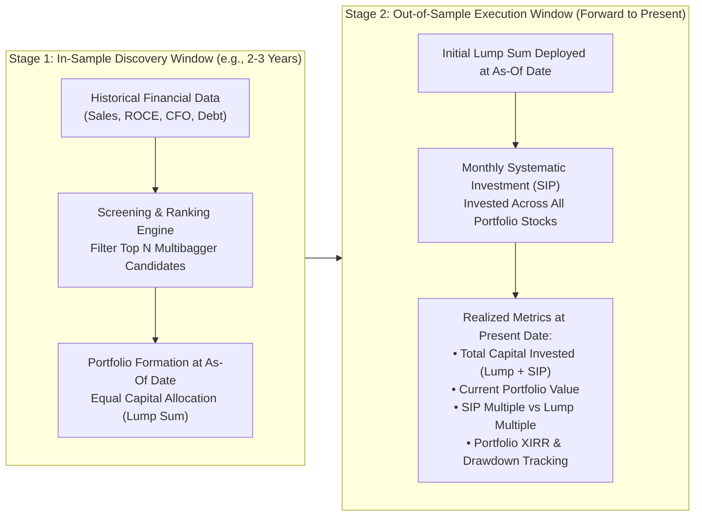

1. **In-Sample Period ($t_{\text{start}}$ to $t_{\text{asof}}$):**  
   - Use only the financial statements, earnings reports, and market cap data published on or before the `asof` date.
   - Screen and rank the universe to select the Top $N$ candidates (e.g., Top 3 to 10 stocks).
   - Commit initial capital (e.g., ₹1,00,000) equally across the Top $N$ stocks on the `asof` date.

2. **Out-of-Sample Confirmation Period ($t_{\text{asof}}$ forward to $t_{\text{today}}$):**  
   - The investor commits systematic monthly capital (e.g., ₹10,000/month SIP) divided across the chosen portfolio stocks.
   - Evaluate performance on $t_{\text{today}}$ using rigorous institutional metrics:
     - **Lump-Sum Multiplier:** Valuation of initial capital relative to entry price.
     - **SIP Multiplier:** Valuation of recurring installments relative to weighted-average cost.
     - **Peak Multiplier:** Highest intra-period valuation multiple achieved.
     - **Portfolio XIRR:** Annualized dollar-weighted rate of return.
     - **Confirmation Status:** Proportion of selected companies delivering $\ge 2\text{x}$ or $\ge 3\text{x}$ outperformance.

---

### 8.4 When to Actually Sell a Multibagger: The 4 Invalidation Pillars
Never sell a multibagger purely because its price has doubled, tripled, or looks expensive on a 1-year forward P/E. High-quality franchises routinely trade at perceived valuation premiums for decades while continuing to compound.

Sell **only** when one of the **Four Invalidation Pillars** is breached:

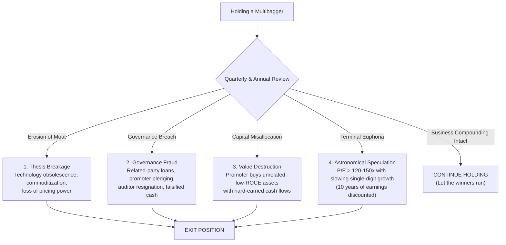

1. **Thesis Breakage / Loss of Moat:** The core competitive advantage erodes permanently. Examples: A disruptive technology renders the product obsolete (e.g., traditional pagers/typewriters); a massive, deep-pocketed conglomerate enters the sector and permanently drives industry pricing below the firm's cost of capital.
2. **Corporate Governance Breach:** Discovery of accounting discrepancies, sudden loans or guarantees to unlisted promoter subsidiaries, unexplained mid-term auditor resignations, or rising promoter pledge. At the first sign of theft, exit immediately—never negotiate with corporate dishonesty.
3. **Capital Misallocation:** The promoter takes high-ROCE cash flows generated by the core business and squanders them on debt-fueled, low-ROCE, unrelated acquisitions (e.g., an adhesive manufacturer acquiring an overseas hospitality chain or real estate venture).
4. **Extreme Terminal Euphoria:** Valuation ascends to extreme irrational heights where more than a decade of future earnings growth is fully priced in (e.g., trailing P/E exceeds 120x–150x while underlying volume growth has decelerated to single digits).

---

## 9. Summary Reference Matrix

### 9.1 Consensus Framework Comparison Matrix

| Framework | Primary Pioneer | Core Focus | Minimum ROCE / ROE | Key Exclusion Criteria | Ideal Market Cap Range |
| :--- | :--- | :--- | :--- | :--- | :--- |
| **S-QGLP** | Raamdeo Agrawal (Motilal Oswal) | Small Size, Quality Moat, High Growth, Longevity, Fair Price | ROCE > 20%<br/>ROE > 18% | Megacaps (> ₹50,000 Cr), cyclical commodity producers, high debt | ₹1,000 Cr – ₹25,000 Cr |
| **SMILE & RISE** | Vijay Kedia | Small size, experienced management, big vision, secular sector | ROCE > 18% | Fresh IPOs, zero-track-record startups, unscalable industries | ₹500 Cr – ₹5,000 Cr |
| **Capital Cycle** | Kenneth Andrade (Old Bridge) | Industry capex freeze, supply-side consolidation, trough survival | ROCE expanding from trough | High-debt operators, aggressive capacity additions during booms | ₹1,000 Cr – ₹15,000 Cr |
| **Secular Compounders** | Basant Maheshwari | Non-cyclical high-margin retail/consumer compounders | ROCE > 30%<br/>Sales Growth > 25% | Cyclicals, capital-intensive B2B commodity businesses | ₹2,000 Cr – ₹30,000 Cr |
| **Coffee Can & Forensics** | Saurabh Mukherjea (Marcellus) | 10-year consistent 10% rev + 15% ROCE; forensic accounting elimination | ROCE > 15% every single year | Bottom 40% forensic ranking ("Zone of Thuggery"), promoter pledging | ₹3,000 Cr – ₹50,000 Cr |

---

### 9.2 The Master Multibagger Identification Architecture

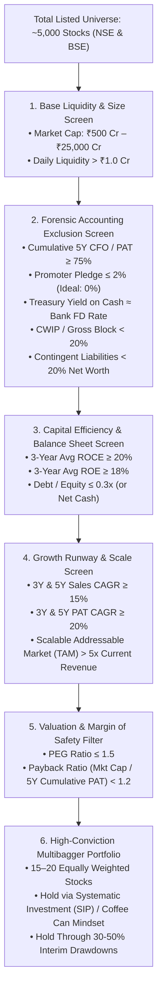

---

## 10. Comprehensive Bibliography, Studies & References

### 10.1 Seminal Books on Multibaggers & Compounding
1. **Phelps, Thomas William.** *100 to 1 in the Stock Market: A Distinguished Security Analyst Tells How to Make More of Your Investment Opportunities*. New York: McGraw-Hill, 1972.  
   *(The pioneering empirical study establishing that 100-baggers require an average holding horizon of 15 to 25 years and resilience through multiple 50% drawdowns).*
2. **Mayer, Christopher.** *100 Baggers: Stocks That Return 100-to-1 and How to Find Them*. Baltimore: Woodman Park Press, 2015.  
   *(Modern study of 365 100-baggers between 1962 and 2014, identifying high ROCE, reinvestment runway, low initial P/E, and small starting market cap as the key drivers).*
3. **Lynch, Peter.** *One Up on Wall Street: How to Use What You Already Know to Make Money in the Market*. New York: Simon & Schuster, 1989.  
   *(Origin of the term 'ten-bagger'; classifies compounders into fast-growers, stalwarts, turnarounds, and asset plays).*
4. **Mukherjea, Saurabh, Rakshit Ranjan, and Pranab Uniyal.** *Coffee Can Investing: The Low Risk Route to Stupendous Wealth*. New Delhi: Penguin Random House India, 2018.  
   *(Formalizes the 10-year 10% revenue growth + 15% ROCE rule for the Indian market).*
5. **Mukherjea, Saurabh.** *The Unusual Billionaires*. New Delhi: Penguin Portfolio, 2016.  
   *(Detailed case studies of historic Indian wealth creators: Asian Paints, Berger Paints, Marico, Page Industries, Astral Poly Technik, HDFC Bank).*
6. **Mukherjea, Saurabh, and Nandita Rajhansa.** *Diamonds in the Dust: Consistent Compounding for Extraordinary Wealth*. New Delhi: Penguin Random House India, 2021.  
   *(Deep dive into Indian forensic accounting red flags, corporate governance manipulation, and the 12-ratio forensic scorecard).*
7. **Maheshwari, Basant.** *The Thoughtful Investor*. Kolkata: Basant Maheshwari Wealth Advisers, 2013.  
   *(Principles of high-ROCE investing, the mathematics of non-dilutive compounding, and managing market volatility in Indian small-caps).*
8. **Schilit, Howard M., Jeremy Perler, and Yoni Engelhart.** *Financial Shenanigans: How to Detect Accounting Gimmicks and Fraud in Financial Reports*. 4th ed. New York: McGraw-Hill, 2018.  
   *(The definitive global textbook on balance sheet, income statement, and cash flow manipulation techniques).*
9. **Chancellor, Edward (Editor).** *Capital Returns: Investing Through the Capital Cycle: A Money Manager’s Reports 2002–15*. London: Palgrave Macmillan, 2015.  
   *(Detailed exposition of the supply-side capital cycle framework popularized in India by Kenneth Andrade).*

---

### 10.2 Motilal Oswal Annual Wealth Creation Studies (Raamdeo Agrawal)
The Motilal Oswal Wealth Creation Studies (WCS), published annually since 1996, represent India's foremost long-term empirical research on equity wealth creation:

- **19th Annual Wealth Creation Study (2014):** *100x: The Science of 100-Baggers.*  
  Analyzed every 100-bagger in India between 1994 and 2014. Key finding: The median 100-bagger compounded at 45% CAGR over 12.3 years; earnings growth contributed 60% of total return, multiple expansion contributed 40%.
- **20th Annual Wealth Creation Study (2015):** *Great, Good, Gruesome: How to Identify Great Companies and Avoid Gruesome Traps.*  
  Categorized businesses by ROE and capital reinvestment rates based on Warren Buffett’s taxonomy.
- **21st Annual Wealth Creation Study (2016):** *Focused Investing: When Less is More.*  
  Demonstrated that 15–20 high-conviction holdings maximize Sharpe and Sortino ratios while minimizing behavioral tracking error.
- **23rd Annual Wealth Creation Study (2018):** *The QGLP Checklist: 25 Questions, 125 Marks.*  
  Established a quantifiable scoring rubric for evaluating Quality, Growth, Longevity, and Price.
- **26th Annual Wealth Creation Study (2021):** *The 100x Playbook: Cross-Cycle Compounding.*  
  Updated empirical study of 100-baggers spanning 1996–2021 across mid-cap manufacturing and digital ecosystems.
- **28th Annual Wealth Creation Study (2023):** *Consolidated Wealth Creators: Capital Allocation & Reinvestment Moats.*  
  Examined how high Incremental Return on Capital Employed (Incremental ROCE) funds self-sustaining capacity expansions without external borrowing.

---

### 10.3 Regulatory Standards & Statutory Disclosures (SEBI & MCA)
1. **Securities and Exchange Board of India (SEBI):**  
   - *Listing Obligations and Disclosure Requirements (LODR) Regulations, 2015* (as amended through 2024). Regulation 23 (Related Party Transactions) and Regulation 30 (Material Event Disclosures).
   - *Substantial Acquisition of Shares and Takeovers (SAST) Regulations, 2011.* Regulation 31 (Disclosure of Encumbered/Pledged Shares).
2. **Ministry of Corporate Affairs (MCA):**  
   - *The Companies Act, 2013.* Section 134 (Financial Statements and Board Reports), Section 188 (Related Party Disclosures), and Section 197 (Managerial Remuneration Limits).
3. **Reserve Bank of India (RBI):**  
   - *Master Directions on Systemically Important Non-Banking Financial Companies (NBFCs).* Asset classification standards, provision coverage ratios (PCR), and capital adequacy benchmarks.

---

### 10.4 Key Academic Papers on Factor Persistence & Structural Return Anomalies
1. **Fama, Eugene F., and Kenneth R. French.** (2015). "A Five-Factor Asset Pricing Model." *Journal of Financial Economics*, 116(1), 1–22.  
   *(Demonstrating that profitability and investment factors explain cross-sectional stock returns beyond size and book-to-market).*
2. **Novy-Marx, Robert.** (2013). "The Other Side of Value: The Gross Profitability Premium." *Journal of Financial Economics*, 108(1), 1–28.  
   *(Proving that highly profitable firms generate significantly superior risk-adjusted returns, and that growth in gross profits is a persistent alpha generator).*
3. **Asness, Clifford S., Andrea Frazzini, and Lasse Heje Pedersen.** (2019). "Quality Minus Junk." *Review of Accounting Studies*, 24(1), 34–112.  
   *(Establishing that high-quality firms—characterized by safety, profitability, high payout, and growth—command higher returns and low drawdowns).*
4. **Sehgal, Sanjay, and Balakrishnan, N.** (2013). "Robustness of Fama-French Factor Models in the Indian Stock Market." *Vikalpa: The Journal for Decision Makers*, 38(1), 119–138.  
   *(Empirical validation of small-cap and quality-profitability factor persistence on the National Stock Exchange of India).*
