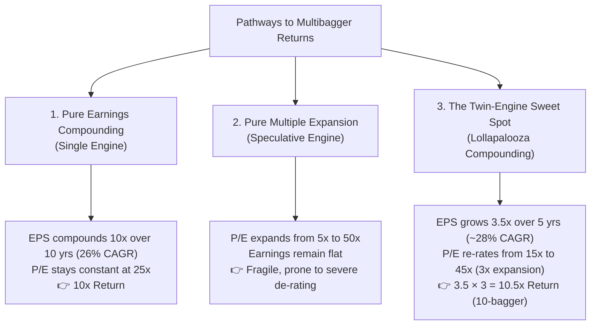
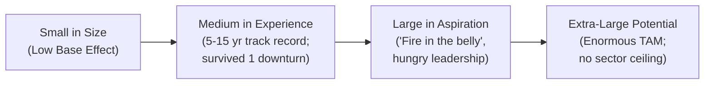
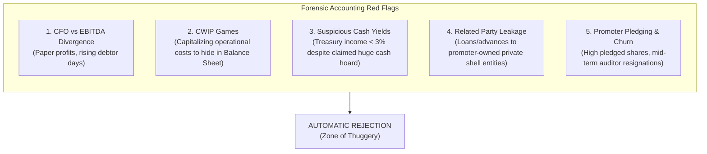
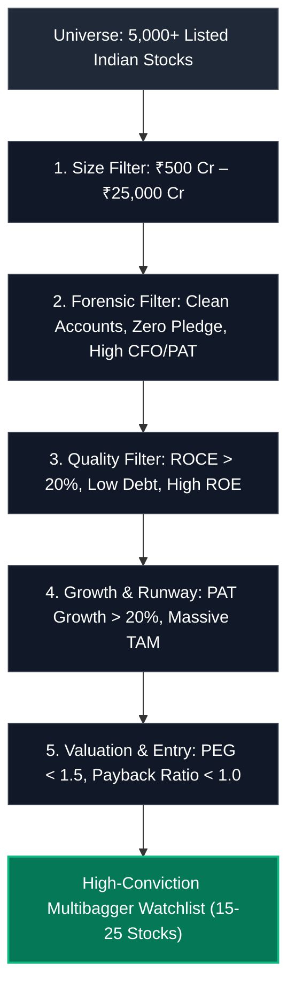

# Multibagger Stocks and Identification: The Indian Market Consensus Framework

---

## 1. Introduction: The Anatomy of a Multibagger

A **multibagger**—a term popularized by legendary investor Peter Lynch in *One Up on Wall Street*—refers to a stock that returns multiple times its original investment cost (e.g., a "10-bagger" generates 10x or 900% returns, a "100-bagger" generates 100x or 9,900% returns).

In the Indian equity markets (NSE/BSE), where nominal GDP compounds at 10–12% (6–7% real GDP + 4–5% inflation) and large informal sectors are steadily being captured by organized players, multibaggers are not statistical anomalies—they are recurring, identifiable events driven by fundamental economic engines.

---

## 2. Growth, Quality of Growth, and Re-Rating: The "Twin-Engine" Principle

Stock returns over multi-year horizons are mathematically governed by a simple relationship:

> **Core Valuation Equations:**
>
> • **Stock Price** = EPS × (P/E)  
> • **Total Return** = (1 + ΔEPS) × (1 + Δ(P/E)) − 1

Multibaggers are generated along three distinct pathways:



### 2.1 Engine 1: Growth in Net Earnings (PAT)
- **Growth::** A prerequisite for a stock to deliver sustained returns. Specifically refers to growth in net earnings (Profit After Tax - PAT), backed by underlying volume growth and revenue expansion rather than one-off balance sheet adjustments.
- High growth without reinvestment capability is self-limiting. The engine requires high **Incremental Return on Capital Employed (Incremental ROCE)** so the business can fund its own expansion without continuous equity dilution or crippling debt.

### 2.2 Engine 2: Valuation Re-Rating (P/E Expansion)
- **Re-rating occurs when the market reclassifies the business:**
  1. *Small-cap → Mid-cap discovery:* From un-researched, illiquid obscurity to institutional coverage (Mutual Funds, FIIs).
  2. *B2B Commodity → Value-added / B2C Brand:* Shift from cyclical margins to pricing power.
  3. *Uncertain governance → Institutional transparency:* Clean professional management, debt retirement, clean audits.
- When earnings growth coincides with valuation re-rating, returns compound non-linearly (the *Lollapalooza effect*).

---

## 3. Core Frameworks from Legendary Indian Investors

Decades of wealth creation across Indian equity cycles (1990s IT boom, 2003–2008 infrastructure cycle, 2010–2020 consumer/private banking boom, and 2020–present manufacturing/energy revival) have crystallized into several consensus frameworks:

### 3.1 Motilal Oswal / Raamdeo Agrawal: The S-QGLP Framework
Formulated by Raamdeo Agrawal across 30+ annual Wealth Creation Studies, **QGLP** (expanded to **S-QGLP** for 10x–100x winners) forms the benchmark for Indian fundamental compounding:

| Pillar | Focus | Indian Market Specification |
| :--- | :--- | :--- |
| **S — Size** | Starting Base Effect | Small-to-Mid cap (Market Cap between ₹1,000 Cr and ₹25,000 Cr). A ₹10 Lakh Cr giant cannot mathematically multiply 10x within a reasonable timeframe due to national GDP ceilings. |
| **Q — Quality** | Business & Management | **Business:** ROCE > 20%, ROE > 18%, net debt-free balance sheet, strong free cash flow (FCF / PAT > 70%).<br/>**Management:** High integrity, capital allocation discipline, promoter skin in the game (> 50% holding, zero pledge). |
| **G — Growth** | Earnings Power | PAT CAGR ≥ 20–25%. Growth must be driven by market share gains, volume growth, and operating leverage rather than raw commodity price spikes. |
| **L — Longevity** | Durability of Moat | Sustained competitive moat over 10–20 years. Favorable alignment with secular *Value Migration* (e.g., PSUs → Private Banks; Unorganized → Branded retail). |
| **P — Price** | Margin of Safety | Favorable entry valuation. PEG ratio ≤ 1.0–1.5. **Payback Ratio** < 1.0 (defined as: Current Market Cap / Cumulative 5-Year PAT). |

---

### 3.2 Vijay Kedia: The SMILE & RISE Framework
Coined by veteran investor Vijay Kedia (backer of 100-baggers like Atul Auto, Cera Sanitaryware, Aegis Logistics):



- **SMILE:**
  - **S (Small in Size):** Small market cap, modest initial market share.
  - **M (Medium in Experience):** Avoid raw startups/fresh unproven IPOs. Pick companies with 5–15 years of operational history that have demonstrated resilience during at least one harsh economic recession.
  - **I / L (Large in Aspiration):** Promoters with intense ambition, clean vision, and hunger to scale.
  - **E (Extra-large in Market Potential):** Massive Total Addressable Market (TAM). Even extraordinary management cannot compound if the industry size is capped.
- **RISE Macro Tailwinds:** Combine SMILE micro-selection with **RISE** sectors:
  - **R** — Renewables & Energy Transition
  - **I** — Infrastructure & Logistics
  - **S** — Security, Defence, & Capital Goods
  - **E** — Emerging Technologies & Manufacturing

---

### 3.3 Kenneth Andrade: The Capital Cycle (Supply-Side Framework)
Pioneered by Kenneth Andrade (Old Bridge Capital / former IDFC Mutual Fund CIO):
- **Premise:** Demand forecasting is prone to forecasting errors; **industry supply is measurable and predictable**.
- **The Cycle Trough:** Look for industries where capital expenditure (capex) has dried up, industry leverage is peak or resolving, and weak competitors are bankrupt or exiting.
- **The Survivor's Advantage:** Identify the 1 or 2 players with pristine, debt-free balance sheets who survive the winter. When demand rebounds even modestly, surviving players experience surging capacity utilization, zero pricing competition, exploding ROCE, and massive re-rating without needing new immediate equity dilution.

---

### 3.4 Basant Maheshwari: Secular High-ROCE Compounders
- Prioritizes companies delivering **Sales CAGR > 25%** and **ROCE > 30%** with negligible equity dilution.
- Recommends paying a **"Scarcity Premium"** for predictable, non-cyclical franchises (retail finance, consumer brands) because their earnings compounding persists irrespective of general macro headwinds.

---

### 3.5 Saurabh Mukherjea (Marcellus): Coffee Can Investing & Forensic Discipline
- Rigorous exclusion based on historical consistency: Minimum 10-year track record of **Revenue Growth > 10%** and **ROCE > 15%** for every single year without interruption.
- Heavy reliance on Howard Schilit's *Financial Shenanigans* forensic model to rank companies into deciles and strictly eliminate the bottom 40% ("Zone of Thuggery").

---

## 4. Indian Structural Tailwinds: Where Multibaggers Breed

Unlike developed, mature economies where growth is incremental, India exhibits powerful, multi-decade structural shifts:

1. **Formalization of the Economy:**
   - GST, e-way bills, and digital payments continuously force market share away from unorganized, tax-evading players into organized, listed market leaders (e.g., pipes, tiles, adhesives, plywood, innerwear, jewelry).
2. **Financialization of Domestic Savings:**
   - Shifting household wealth from physical assets (gold, unorganized real estate) into financial assets (equities, SIPs, mutual funds, insurance, wealth management).
3. **China+1, PLI, and Indigenization:**
   - Global supply-chain de-risking driving sustained multi-year export order books in **Specialty Chemicals**, **Active Pharmaceutical Ingredients (APIs) / CDMO**, **Electronics Manufacturing Services (EMS)**, and domestic **Defence procurement**.
4. **Premiumization and Discretionary Consumption:**
   - Rising per-capita GDP crossing the USD 2,500 threshold, unlocking non-linear inflection in discretionary spend: premium passenger vehicles, high-end real estate, branded dining/QSR, tourism, healthcare diagnostics.
5. **Capex & Infrastructure Modernization:**
   - Massive public and private capex into national transport corridors, power grid modernization, renewable energy storage, and industrial automation.

---

## 5. Forensic Accounting: The Indian Market "Zone of Thuggery" Filter

In small-cap and mid-cap Indian equities, corporate governance failures and accounting manipulation are the leading killers of prospective multibaggers. An investor must eliminate fraudulent businesses before analyzing growth.



### Critical Forensic Red Flags & Thresholds
1. **Operating Cash Flow (CFO) vs. Net Profit (PAT):**
   - *Test:* Over a 3-to-5-year rolling period, Cumulative CFO must be ≥ 70–80% of Cumulative PAT.
   - *Red Flag:* Growing PAT alongside stagnant or negative CFO indicates aggressive revenue recognition, channel stuffing, or uncollected receivables.
2. **Debtor Days Stretch:**
   - *Red Flag:* Trade receivables growing significantly faster than sales, or debtor days expanding by > 30 days within 2 years.
3. **Capital Work-In-Progress (CWIP) as % of Gross Block:**
   - *Red Flag:* CWIP > 25–30% of Gross Block lingering for more than 2–3 consecutive years without commercialization. Promoters often hide operational expenses in CWIP to inflate reported P&L profits.
4. **Interest Income vs. Cash Balances (The "Fake Cash" Check):**
   - *Test:* Effective Yield = Other Income (Interest) / (Cash + Bank Balances)
   - *Red Flag:* If the yield is under 3–4% while commercial bank FD rates are 6–7%, the cash balance may be fictitious or encumbered as collateral for unlisted promoter loans.
5. **Auditor Quality and Turnover:**
   - *Red Flag:* Frequent mid-term auditor resignations, especially right before Q4 annual audited statements.
   - *Red Flag:* Auditor remuneration growing at 3× the rate of revenue growth.
6. **Promoter Pledging:**
   - *Threshold:* Ideal = 0%; Maximum tolerable = < 5%.
   - *Red Flag:* Promoter pledge > 15–20% exposes the stock to catastrophic margin call liquidations during market corrections.

---

## 6. Actionable Quantitative Screening Checklist

The general consensus among Indian fund managers and high-conviction screeners yields the following multi-stage funnel:

| Filter Stage | Metric | Minimum Threshold | Ideal / High-Conviction |
| :--- | :--- | :--- | :--- |
| **Stage 1: Base Size** | Market Capitalization | ₹500 Cr – ₹25,000 Cr | ₹1,500 Cr – ₹10,000 Cr |
| **Stage 2: Growth Engine** | Sales Growth (3Y & 5Y CAGR) | ≥ 15% | ≥ 20% |
| **Stage 2: Growth Engine** | PAT Growth (3Y & 5Y CAGR) | ≥ 18% | ≥ 25% |
| **Stage 3: Capital Efficiency** | ROCE (3Y Average) | ≥ 18% | ≥ 25% |
| **Stage 3: Capital Efficiency** | ROE (3Y Average) | ≥ 15% | ≥ 20% |
| **Stage 3: Capital Efficiency** | Debt to Equity Ratio | ≤ 0.5 | ≤ 0.1 (or Net Cash) |
| **Stage 4: Cash Flow Quality** | CFO / PAT (5Y Cumulative) | ≥ 70% | ≥ 85% |
| **Stage 4: Cash Flow Quality** | Free Cash Flow (FCF) | Positive over 3 years | Consistently expanding |
| **Stage 5: Governance & Float** | Promoter Holding | ≥ 50% | ≥ 60% |
| **Stage 5: Governance & Float** | Pledged Promoter Shares | ≤ 2% | 0.0% |
| **Stage 5: Governance & Float** | Institutional Holding | ≤ 25% (Room for discovery) | 5% – 15% |
| **Stage 6: Valuation Comfort** | PEG Ratio | ≤ 1.5 | ≤ 1.0 |

---

## 7. Screener Implementations

### 7.1 Screener.in Exact Query Syntax
Paste this query directly into [Screener.in Custom Query](https://www.screener.in/create/):

> **Note on Screener.in Variable Names:**  
> Screener.in uses `Operating cash flow 3years` / `Operating cash flow 5years` for multi-year cumulative cash flows (the phrase `Cash from operations` is strictly reserved for single annual years like `Cash from operations last year`).

```sql
Market Capitalization > 500 AND
Market Capitalization < 25000 AND
Sales growth 3Years > 15 AND
Sales growth 5Years > 12 AND
Profit growth 3Years > 18 AND
Profit growth 5Years > 15 AND
Return on capital employed > 20 AND
Average return on capital employed 3Years > 18 AND
Average return on capital employed 5Years > 18 AND
Return on equity > 15 AND
Debt to equity < 0.5 AND
Operating cash flow 3years > 0 AND
Cash from operations last year >= 0.75 * Net profit AND
Free cash flow 3years > 0 AND
Pledged percentage < 2 AND
Promoter holding > 50 AND
Contingent liabilities < 0.2 * Net worth AND
PEG Ratio < 1.5
```

### 7.2 Honba Tier 1 Grammar Filter Query
Using Honba's built-in screener language ([`honba.screener`](file:///home/pmallapp/Devel/Finance/honba-labs/honba/python/src/honba/screener)):

```text
market_cap > 5000000000 AND market_cap < 250000000000 AND
sales_growth_3y > 15 AND
pat_growth_3y > 18 AND
roce_3y_avg > 18 AND
debt_to_equity < 0.5 AND
cfo_to_pat_3y > 0.75 AND
promoter_pledge < 2 AND
promoter_holding > 50 AND
peg_ratio < 1.5
```

---

## 8. Portfolio Construction, Psychology, and Exit Discipline

Even when an investor successfully identifies a future multibagger, behavioral pitfalls often prevent realizing multi-bagger gains:

### 8.1 The "Volatility Tax" (Drawdown Reality)
- Every historical 100-bagger in the Indian market (Titan, Bajaj Finance, PI Industries, Astral Pipes) has experienced:
  - **At least 3 to 5 drawdowns of 30% to 50%** over its 10-to-15-year compounding journey.
  - Extended 12-to-18-month periods of sideways price consolidation where earnings continued to grow while valuations compressed.
- Investors who use tight technical stop-losses on fundamental compounders invariably get shaken out before the multi-bagger move unfolds.

### 8.2 The Coffee Can Mentality
- Robert Kirby's "Coffee Can" philosophy (re-popularized in India by Saurabh Mukherjea): The best returns accrue when high-quality stocks are bought and intentionally "forgotten" for 5 to 10 years, avoiding the impulse to trim winners to buy underperforming laggards.

### 8.3 When to Actually Sell a Multibagger
Do not sell merely because the stock has doubled or tripled or looks temporarily expensive on trailing P/E. Exit only when one of four structural triggers occurs:

1. **Thesis Breakage / Loss of Moat:** The core competitive advantage erodes (e.g., disruptive technology makes product obsolete; new aggressive entrant destroys industry pricing power).
2. **Corporate Governance Breach:** Discovery of accounting discrepancies, sudden unannounced related-party transactions, un-explained auditor resignation, or rising promoter pledge.
3. **Capital Misallocation:** The promoter takes free cash flow earned from the high-ROCE core business and squanders it on unrelated, low-ROCE, debt-funded acquisitions.
4. **Extreme Terminal Euphoria:** Valuation reaches irrational speculative bubbles (e.g., P/E > 120–150x with slowing single-digit volume growth) where 10 years of future earnings are already priced in.

---

## 9. Summary Reference Matrix


